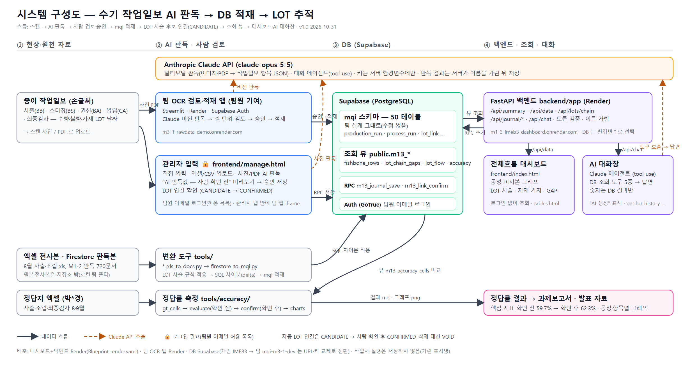

# M1-3 — 수기 작업일보 AI 판독 → DB 적재 → LOT 추적 서비스

> 코디세이 AI 네이티브 Final Project (팀과제 M3-1) · 개인과제 M1-2 의 대화창·대시보드를 그대로 가져와 DB 만 팀 Supabase `mqi` 스키마로 바꿔 확장한 통합 작업 저장소입니다.
> 발표 2026-11-12 · 최종 수정 2026-11-07

## 바로 열어 보기

| 구분 | 링크 | 메모 |
|---|---|---|
| 🖥️ **전체흐름 대시보드** (배포) | https://m1-3-imeb3-dashboard.onrender.com | 로그인 없이 조회. 공정 흐름 피시본 그래프 + AI 대화창. 무료 플랜이라 첫 접속은 30\~60초 대기 |
| 📊 표·그래프 보기 | https://m1-3-imeb3-dashboard.onrender.com/tables.html | 개요·공정별 일자 그래프·LOT 사슬 점검표 |
| 🔒 관리자 입력 | https://m1-3-imeb3-dashboard.onrender.com/manage.html | 팀원 이메일 로그인 후 직접 입력·엑셀 업로드·사진 AI 판독·연결 확인 |
| 🩺 서버 상태 | https://m1-3-imeb3-dashboard.onrender.com/api/health | DB 연결·행 수·AI 키 설정 여부 |
| 🏭 공정별 화면 바로 열기 | [비전 불량](https://m1-3-imeb3-dashboard.onrender.com/index.html?proc=BA&view=vision&mode=range&from=2026-09-01&to=2026-10-31) · [리워크](https://m1-3-imeb3-dashboard.onrender.com/index.html?proc=CA&view=rework&mode=range&from=2026-10-01&to=2026-10-31) · [최종검사 불량 유형](https://m1-3-imeb3-dashboard.onrender.com/index.html?proc=FINAL_INSPECTION&view=defect&mode=range&from=2026-09-01&to=2026-09-30) · [CA 초품 위치도](https://m1-3-imeb3-dashboard.onrender.com/index.html?proc=CA&view=position) · [보빈 위치도](https://m1-3-imeb3-dashboard.onrender.com/index.html?proc=INJECTION&view=bobbin&mode=range&from=2026-08-01&to=2026-10-31) · [사출조건](https://m1-3-imeb3-dashboard.onrender.com/index.html?proc=INJECTION&view=cond) · [BS 일별](https://m1-3-imeb3-dashboard.onrender.com/index.html?proc=STITCHING&view=daily&mode=range&from=2026-09-01&to=2026-09-30) | 전체 목록·설명은 [과제보고서 '화면 바로 열기'](docs/M3-1_과제보고서.md#화면-바로-열기) |
| 🔒 관리 화면 탭 바로 열기 | [사출·조립](https://m1-3-imeb3-dashboard.onrender.com/manage.html?tab=mixed) · [BS](https://m1-3-imeb3-dashboard.onrender.com/manage.html?tab=bs) · [비전 불량](https://m1-3-imeb3-dashboard.onrender.com/manage.html?tab=vision) · [CA 위치도](https://m1-3-imeb3-dashboard.onrender.com/manage.html?tab=position) · [리워크](https://m1-3-imeb3-dashboard.onrender.com/manage.html?tab=rework) · [최종검사·재검](https://m1-3-imeb3-dashboard.onrender.com/manage.html?tab=final) | 로그인 필요 |
| 📷 팀 OCR 검토·적재 앱 (팀원 배포) | https://m3-1-rawdata-demo.onrender.com | Streamlit, 관리자 입력 탭 안에 연결됨 |
| 📋 **과제보고서** (살아 있는 문서) | [docs/M3-1_과제보고서.md](docs/M3-1_과제보고서.md) | 진척도·필수 요건 체크리스트·일정·변경 이력 |
| 📝 기획서 | [docs/기획서.md](docs/기획서.md) | 문제 정의·타겟 사용자·AI 활용 방식 |
| 📝 기능 요구 명세서 | [docs/기능요구명세서.md](docs/기능요구명세서.md) | FR 24 · NFR 9 |
| 📝 시스템 아키텍처 | [docs/시스템아키텍처.md](docs/시스템아키텍처.md) · [구성도 그림](docs/img/시스템아키텍처_구성도.png) | 스캔 → AI → DB → 대시보드/채팅 구성도 |
| 🔐 개인정보 처리 방침 | [docs/개인정보_처리방침.md](docs/개인정보_처리방침.md) | 실명 미저장(가린 표시명), 외부 전송 범위, 테스터 동의 문구, 보존·삭제 |
| 🧪 사용자 테스트 안내문 | [docs/사용자테스트/테스터_안내문.md](docs/사용자테스트/테스터_안내문.md) | 혼자 진행하는 과제 5개(10월 작업일보 실제 입력 포함), 동의, 진행자 체크리스트 |
| 📝 사용자 테스트 설문 | https://m1-3-imeb3-dashboard.onrender.com/survey.html | 로그인 없이 제출, 이름·이메일 없음, 11/13 마감 (대시보드 위쪽 '📝 설문' 단추) |
| 📈 OCR 정답률 그래프 | [공정·항목별](docs/img/정답률_1_공정항목.png) · [오류 분석](docs/img/정답률_2_오류분석.png) | 확인 후 핵심 지표 62.3% |



## 1. 개요

IV/OV/HSV 세 모델은 **사출 → 스티칭 → 권선(BA) → 압입(CA) → 최종검사** 다섯 공정을 거치고, 공정마다 종이 작업일보에 손글씨로 생산수량·불량수량·작업시간·투입 자재 LOT 날짜를 적습니다. 종이에만 있는 기록이라 "이 LOT 이 어느 사출 LOT 에서 왔고 어디로 검사·출하됐는지"를 추적할 수 없었습니다.

이 서비스는 그 흐름을 다음 세 단계로 바꿉니다.

1. **AI 판독(멀티모달)** — 작업일보 사진·PDF 를 Claude 가 읽어 공정별 필수 항목(수량·불량·자재 LOT)을 구조화합니다. 결과는 "AI 판독값 — 사람 확인 전" 으로 표시되고, 사람이 승인해야 DB 에 들어갑니다.
2. **DB 적재(자동화 워크플로우)** — 팀 설계 Supabase `mqi` 스키마(50 테이블)에 적재합니다. 공정 간 LOT 연결은 날짜 규칙으로 후보(`CANDIDATE`)를 만들고 사람이 확정합니다.
3. **LOT 추적·AI 대화창(AI Agent)** — 대시보드가 사출부터 최종검사까지 사슬을 그래프로 보여 주고, 대화창의 Claude 에이전트가 DB 조회 도구를 골라 "이 LOT 어디로 갔어?" 같은 질문에 답합니다. 숫자는 DB 조회 결과만 사용합니다.

### 1-1. 진행 과정 한눈에 보기 (시간순 · 무엇을 하고, 무엇이 막혔고, 어떻게 고쳤나)

```
① 출발 점검 → ② 개인 DB·변환 → ③ LOT 사슬 규칙 → ④ 8월 원천 보강 → ⑤ 정답률 측정
→ ⑥ 배포·화면 교체 → ⑦ 원본 대조 정정 → ⑧ 품질 기록(사출조건·위치도·재검) → ⑨ 관리 화면 입력 체계
→ ⑩ LOT 추적 규칙 하나로 → ⑪ 10월 데이터를 실제 서비스 흐름으로 입력 → ⑫ 공정별 품질 화면·리워크
```

| 단계 | 날짜 | 한 일 | 막힌 점 → 고친 방법 | 결과 |
|---|---|---|---|---|
| ① 출발 점검 | 10/29 | 개인과제 M1-2(대화창·대시보드)와 팀과제 M3-1(DB 50 테이블)을 분석 | 팀 DB 에는 실제 데이터가 3일치뿐이고 **쓰기 권한이 없음** → 팀 설계를 그대로 복사한 개인 DB 를 만들어 거기서 작업하기로 | 할 일과 방향 확정 |
| ② 개인 DB·변환 | 10/29 | 팀 마이그레이션을 **한 글자도 고치지 않고** 개인 DB 에 적용, 기존 판독 데이터(Firestore 720건)를 팀 표 형식으로 바꾸는 변환기 작성 | 나중에 팀 DB 로 옮길 때 코드를 바꾸지 않으려면 표 구조가 같아야 함 → 추가로 필요한 것은 조회용 뷰·저장 함수만 따로 파일로 | 테이블·연결·제약 모두 팀과 동일, 4,097행 적재 |
| ③ LOT 사슬 규칙 | 10/29 | 사출 → 스티칭 → 권선 → 압입 → 최종검사를 LOT 으로 잇는 규칙 정리(15일 범위, 보빈 날짜, 마킹코드 조견표, 자재 LOT 가지) | 처음엔 완전히 이어진 LOT 이 57개 중 7개뿐 → 일보마다 적힌 투입 LOT 날짜를 공정별로 다시 읽어 연결 | 완전 사슬 7 → 25 |
| ④ 8월 원천 보강 | 10/30 | 8월 사출·조립 일보 엑셀 원천을 찾아 적재 | 통합 자료에 8월 사출 일보가 8건뿐이라 사슬이 끊김 → 원천 xls 18장을 읽는 도구를 만들어 보충 | 완전 사슬 25 → 41 → 49 |
| ⑤ 정답률 측정 | 10/30\~31 | 정답지 엑셀과 DB 값을 칸마다 자동 비교하는 측정기 | 틀린 칸 219개가 정말 AI 잘못인지 모름 → 원본 PDF 를 한 칸씩 대조해 'AI 오류 / 정답지 오류 / 판단 불가'로 나눔 | AI 판독 정답률 59.7% → 확인 후 **62.3%**, 정답지 오류 8건 발견 |
| ⑥ 배포·화면 교체 | 10/30\~31 | Render 배포, 팀원 이메일 로그인, 대시보드를 M1-2 화면 그대로로 교체(데이터만 팀 DB) | 사진 판독이 400 오류로 멈춤 → 응답 형식을 바꾸고 검증 단계 추가 | 외부 접속·로그인 동작 |
| ⑦ 원본 대조 정정 | 10/31\~11/2 | AI 가 잘못 읽은 값을 원본과 대조해 고침(생산수량 60건 등), 최종검사 LOT 코드를 정답지와 대조 | 그래프가 화면 코드 속 '날짜별 보정'에 기대고 있었고, 못 읽은 LOT 을 가까운 날짜로 **추정 연결**하고 있었음 → 보정 코드를 지우고 DB 값만 쓰기, 추정 연결 걷어내기 | "그래프 = DB 결과" 원칙 확립 |
| ⑧ 품질 기록 추가 | 11/2\~11/6 | 사출조건 체크시트, CA·보빈 초품 위치도, 최종검사 재검사를 팀 표에 저장하고 화면에 표시 | 새 표를 만들면 팀 DB 와 달라짐 → 팀 표(검사·측정·조건 표)에 맞춰 넣고 판정 기준도 DB 에 등록 | 사출조건 25탭, 위치도 140여 회, 재검 연결 |
| ⑨ 관리 화면 입력 체계 | 11/3\~11/7 | 공정 순서 탭(사출조건 → 보빈 위치도 → 사출·조립 일보 → BS → 비전 불량 → CA 위치도 → 최종검사), 모든 탭에 저장 목록·중복 표시·삭제 | 판독이 틀리면 고칠 곳이 없었고, 같은 일보가 두 번 저장되기도 함 → '고치기'(사람이 고친 칸은 따로 기록), 같은 일보 중복 저장 막기, 최근 30건 목록, 작업자 이름은 가린 이름만 저장 | 판독 → 사람 확인 → 저장 흐름 완성 |
| ⑩ LOT 추적 규칙 하나로 | 11/7 | 날짜·공정·LOT 어떤 질문이든 **같은 DB 연결 규칙**으로 앞뒤 양방향 추적, 대화 질문에 따라 모든 화면이 함께 바뀜 | 질문 종류마다 규칙이 달라 특정 날짜만 맞는 일이 생김 → 날짜만 물으면 제품(CA) 기준, 공정을 말하면 그 공정 기준으로 통일 | 완전 사슬 51 / 76 |
| ⑪ 10월 데이터 입력 | 11/7\~ | 정답지·전사본이 없는 10월을 **관리 화면 Claude OCR 판독**으로 입력, 비전 가성불량 재검사는 엑셀 탭 | 사출·조립이 한 PDF 에 섞여 있고 다른 제품 쪽도 있음 → 쪽마다 종류를 스스로 판단하고 다른 제품 쪽은 제외. 조립 불량 이름을 양식 그대로 고정, 기존 작업자 목록을 힌트로 | 작업일보 40건·최종검사 45건 (11/7 기준, 입력 중) |
| ⑫ 공정별 품질 화면·리워크 | 11/7 저녁 | 권선 비전 불량(가성/진성 엑셀), 최종검사 불량 유형 묶음·세로 막대, **리워크 작업일보**(Claude 판독, 시리얼 범위, LOT 별 투입, 특이사항), 재검 직접 추가 | 리워크를 재검으로 저장했다가 팀장 지적 → **다시 작업하는 공정**(process_run REWORK)으로 바꿈. 시리얼은 1:1 이 아니라 LOT 번호 범위. 다른 제품(MEB5) 칸의 탈피·납조 불량 정리 | 리워크 32건·17 LOT · 비전 재검 195건 |

**일하면서 지킨 원칙 (고치다가 생긴 규칙)**

- **추정하지 않는다** — 못 읽은 LOT 은 가까운 날짜로 짐작해 잇지 않고 '미연결'로 남깁니다.
- **그래프는 DB 결과만** — 화면에서 숫자를 고쳐 보이게 하지 않고, 틀리면 DB 를 고칩니다.
- **지우지 않고 무효 처리** — 삭제는 '무효(VOID)'로 표시하고, 누가·왜 바꿨는지 이력을 남깁니다.
- **팀 표 구조는 그대로** — 필요한 것은 조회용 뷰·저장 함수로만 더하고, 팀 DB 로는 접속 주소만 바꿔 옮깁니다.
- **실명은 저장하지 않는다** — 작업자·검사자는 가운데 글자를 가린 이름만 저장합니다.

## 2. 팀원 및 역할

| 이름 | 역할 | 담당 |
|---|---|---|
| 강*아 | **팀장** · Domain / AI | 프로젝트 총괄, 도메인 설계, AI 대화창, 배포 |
| 이*규 | DB / Backend | Supabase `mqi` 스키마 설계·마이그레이션, 팀 OCR 검토·적재 앱 배포 |
| 이*관 | Frontend | 팀 대시보드, 그래프 최적화, 데이터 검수 |
| 박*경 | Data / AI | 수기일보 정답지 작성, AI 판독(OCR), 정답률 기준서 |

### 기여 구분

| 영역 | 내용 | 기여자 |
|---|---|---|
| 총괄 · 도메인 · AI | 프로젝트 총괄, 도메인 설계(LOT 사슬·최종검사·재검·리워크 규칙), AI 대화창(Claude 에이전트 + DB 조회 도구), 관리 화면 Claude 판독 입력, 배포 | 강*아 |
| DB · 백엔드 | `mqi` 50개 테이블 설계·마이그레이션, 백엔드, 팀 OCR 검토·적재 앱(Streamlit) 배포, mqi 엑셀 초안·`repository.py` | 이*규 |
| 프론트엔드 | 대시보드, 그래프 최적화(제목·공정 흐름·그래프 메뉴 정리 10/31, 모델별 그래프 색상 통일 11/2 PR #2), 데이터 검수(스티칭 불량명 통합) | 이*관 |
| 데이터 · AI 판독 | 수기일보 정답지 작성·분석, AI 판독(OCR) 9월 판독본, 정답률 기준서 | 박*경 |

## 3. 기술 스택

| 영역 | 사용 기술 |
|---|---|
| AI | Anthropic Claude API (`claude-opus-5-5`) — 이미지·PDF 판독, 대화창 에이전트(tool use) |
| 백엔드 | Python 3.12, FastAPI, Uvicorn, httpx, pydantic v2 |
| DB | Supabase (PostgreSQL) `mqi` 스키마 50 테이블 + 조회 뷰 `public.m13_*` + 쓰기 RPC `m13_journal_save`·`m13_link_confirm` |
| 인증 | Supabase Auth 이메일 로그인(허용 목록 `MQI_ALLOWED_EMAILS`), 서버에서 GoTrue 토큰 검증 |
| 프론트엔드 | 순수 HTML/JS (빌드 없음) — `index.html` 피시본 그래프, `tables.html`, `manage.html` |
| 배포 | Render (Blueprint `render.yaml`, FastAPI 하나가 API 와 정적 파일을 함께 서빙), GitHub push 로 자동 재배포 |
| 도구 | openpyxl(엑셀 전사본·정답지), 변환·정답률 스크립트(`tools/`) |

## 4. 실행 방법

### 로컬

1. `backend/.env.example` 을 `backend/.env.personal` 로 복사하고 `SUPABASE_SERVICE_ROLE_KEY`, `SUPABASE_PUBLISHABLE_KEY`, `ANTHROPIC_API_KEY`, `MQI_ALLOWED_EMAILS` 를 채웁니다.
2. `대시보드_실행.bat` 을 더블클릭합니다 (의존성 설치 후 http://127.0.0.1:8800 이 열립니다).
   수동 실행: `cd backend && py -m uvicorn app.main:app --port 8800 --reload`
3. 메인 대시보드는 로그인 없이 조회합니다. "관리자 입력 🔒" 탭만 이메일 로그인이 필요하며, 계정은 `py tools/auth_admin.py create <email>` 로 만듭니다.

### 배포 (Render)

- `render.yaml` Blueprint 로 배포합니다. 비밀값(`SUPABASE_SERVICE_ROLE_KEY`, `SUPABASE_PUBLISHABLE_KEY`, `MQI_ALLOWED_EMAILS`, `ANTHROPIC_API_KEY`)은 Render 화면에서 직접 입력합니다.
- `main` 에 push 하면 약 1\~2분 뒤 자동 재배포됩니다. 상태는 [/api/health](https://m1-3-imeb3-dashboard.onrender.com/api/health) 에서 확인합니다.
- 팀 DB 로 전환할 때는 `SUPABASE_PROJECT_REF`·`SUPABASE_URL`·키만 바꿉니다. 스키마가 팀과 동일하므로 코드 변경은 없습니다.

## 5. 결과 (2026-10-31 기준)

| 항목 | 결과 |
|---|---|
| OCR 정답률(핵심: 생산수량·불량수량) | 확인 전 59.7% (531칸) → **원본 대조 확인 후 62.3%** (520칸). 생산수량 69.0%, 불량 유형별 58.2%, 자재 LOT 날짜 54.9%, 작업시간 42.5% |
| 주요 오류 유형 | 값 누락 92, 숫자 오독 84(8↔6·7↔1), 행 밀림 8, 정답지 오류 8건 발견 |
| DB 적재 | 8·9월 판독본 + 8월 전사본: production_lot 348, process_run 286, inspection_run 330, material_usage 527, quality_finding 1,000+ |
| Claude 판독 비용·시간 | 11/7 하루 실측 **138쪽 · 입력 132만/출력 21만 토큰 · 판독 32분 · 약 $9.5(≈1.3만 원)**. 사진 한 쪽 ≈ 1만 토큰 · 13초 · 약 95원(조립 일보는 출력이 많아 약 190원). 하루 생산분(약 29쪽) 기준 약 2,800원·7분 — 근거: 관리 화면 '판독 기록' 탭(뷰 `m13_ai_calls`), [과제보고서 3-10](docs/M3-1_과제보고서.md#3-10-판독-실행-기록--문서-종류별-토큰판독-시간) |
| 10월 데이터 | **10월 데이터는 관리 화면의 Claude OCR 판독으로 올렸습니다**(11/7\~, 엑셀 전사본 없이 원본 PDF → 판독 → 사람이 '고치기'로 확인 → 저장). 11/7 기준 작업일보 사출 4·BS 12·권선(BA) 12·압입(CA) 12건(10/1\~10/12), 최종검사 본검사 42·1차 3건(10/1\~10/7), 판독 호출 65쪽. 비전 가성불량 재검사는 엑셀(조치 내역 9·10월)을 관리 화면 '비전 불량' 탭으로 올림(10월 54건) |
| LOT 추적 | CA LOT 76개 중 **완전 사슬(사출→최종검사) 51개**. 나머지는 주로 7월 일보 미수록 |
| 서비스 | 대시보드·AI 대화창·관리자 입력(사진 OCR 포함) Render 배포, 팀원 이메일 로그인 |

정답률 계산은 `tools/accuracy/`(정답지 → 칸, DB 뷰 `m13_accuracy_cells`, 팀 기준서 v1.0 판정식)로 재현할 수 있습니다. 그래프: [공정·항목별](docs/img/정답률_1_공정항목.png) · [오류 분석](docs/img/정답률_2_오류분석.png).

## 6. 화면 구성

| 화면 | 내용 |
|---|---|
| [전체흐름 대시보드](https://m1-3-imeb3-dashboard.onrender.com) `frontend/index.html` | 개인과제 M1-2 화면 그대로 — 모델 색(IV 검정·OV 노랑·HSV 파랑), 공정 뼈대 피시본 그래프, 원소재 LOT 가지, BA·CA 수량 GAP, 검사일별 상자, AI 대화창. 데이터는 뷰 `m13_fishbone_rows` → `/api/data` |
| [표·그래프](https://m1-3-imeb3-dashboard.onrender.com/tables.html) `frontend/tables.html` | 개요·공정별 일자 그래프·사슬 점검표·관리자 입력 탭(팀 OCR 앱 연결) |
| [관리자 입력](https://m1-3-imeb3-dashboard.onrender.com/manage.html) `frontend/manage.html` | 직접 입력 / 엑셀·CSV / 사진·PDF AI 판독(미리보기 → 승인 저장) / 연결 확인 |

AI 가 만든 내용은 화면에 "AI(Claude) 생성", "AI 판독값 — 사람 확인 전" 으로 표시합니다. 작업자 이름은 DB 에 가린 표시명만 저장하고 OCR 프롬프트는 이름을 기록하지 않습니다.

## 7. 저장소 구조

| 경로 | 내용 |
|---|---|
| `backend/app/config.py` | `.env.personal` / `.env.team` 선택(`M13_ENV`). 팀 DB 는 자동 읽기 전용 |
| `backend/app/routers/api.py` | REST API (`/api/summary`, `/api/data`, `/api/lots/chain`, `/api/journal/*`, `/api/chat`, 인증) |
| `backend/app/db/supabase_client.py` | PostgREST 얇은 클라이언트(REST 조회 + RPC 쓰기) |
| `backend/app/repository/` | 데이터 계층 인터페이스와 Supabase 구현. 화면·에이전트는 이것만 사용 |
| `backend/app/ingest/journal_payload.py` | 작업일보 1장 형식(JournalPayload). 투입 LOT·원자재 LOT = 사슬 |
| `backend/app/ingest/excel_csv.py`, `image.py` | 엑셀·CSV 행 → 작업일보, 사진·PDF → Claude 판독(미리보기 전용) |
| `backend/app/agent/claude_agent.py` | AI 대화창. 도구 5개(팀 챗봇 규약 이름), 숫자는 DB 조회만 |
| `backend/app/auth/supabase_auth.py` | 팀 Streamlit `auth.py` 규칙을 FastAPI 로 이식한 이메일 로그인 |
| `frontend/` | `index.html` · `tables.html` · `manage.html` |
| `supabase/migrations/` | 팀 기준 SQL(수정 없음) + 개인 전용 권한·뷰·RPC(파일 머리에 "개인 프로젝트 전용") |
| `tools/firestore_to_mqi.py` | Firestore CSV → `mqi` 적재 SQL + 보고서 (LOT 사슬 규칙 포함) |
| `tools/injection_xls_to_docs.py`, `assembly_xls_to_docs.py` | 8월 사출·조립 엑셀 전사본 → 통합 문서 |
| `tools/accuracy/` | OCR 정답률 측정(정답지 → 칸 → 판정 → 확인 후 보정) |
| `tools/auth_admin.py` | 로그인 계정 생성 |
| `docs/` | 과제보고서·기획서·명세서·아키텍처만 공개. 작업 기록은 실제 제조 기록이 있어 로컬 전용 |

## 8. 원칙

- Supabase `mqi` 의 테이블·컬럼·제약조건은 바꾸지 않습니다. 팀 기준 마이그레이션을 수정 없이 적용하고 기존 구조에 맞춰 행만 넣습니다 (`AGENTS.md`).
- 팀 DB(`mqi-m3-1-dev`)는 조회만 합니다. 쓰기는 개인 프로젝트 `IMEB3 DB`(동일 스키마)에서 검증한 뒤 DB 담당 승인 후 전환합니다.
- 실제 제조 기록(`*.xlsx`, `*.csv`, 원본 PDF/사진, 변환 결과 `outputs/`)은 GitHub 에 올리지 않습니다.
- LOT 연결은 사람이 확인하기 전까지 `CANDIDATE` 로 넣습니다. 사람이 고친 값은 출처(`corrected_by`, `HUMAN_VERIFIED`)를 함께 남깁니다.
- 팀원·작업자 이름은 가운데를 가리고, 이메일은 어디에도 적지 않습니다. 자세한 기준은 [개인정보 처리 방침](docs/개인정보_처리방침.md)에 있습니다.

## 9. 진척 현황 (2026-11-08)

세부 근거와 필수 요건 체크리스트는 [과제보고서](docs/M3-1_과제보고서.md)에 있습니다. 비율은 자체 추정치입니다. **제출 마감 2026-11-08(일) 14:00**, 사용자 테스트는 11/8 시작해 11/13 까지 설문을 받고, 결과는 마감 뒤 보완합니다.

| 영역 | 상태·진척 | 현재 기준 |
|---|---:|---|
| 기획서 | 🟡 80% | 초안 v0.1. 사용자 테스트 결과는 마감 뒤 반영 |
| 요구 명세서·아키텍처 | 🟡 80% | 명세서 초안 v0.1, 아키텍처 v0.2(그림 구성도) |
| AI 판독(OCR) | 🟡 70% | 관리 화면에서 사출·BS·조립·최종검사 작업일보를 Claude 로 매일 판독(공정 힌트, 여러 쪽 PDF 한 쪽씩, 비고 재검 자동 분리), 고친 칸은 사람 판독으로 기록 |
| 정답률 측정 | 🟡 85% | 확인 후 62.3%. 문서 종류별 토큰·판독 시간은 '판독 기록' 탭(11/7\~) |
| DB 적재 | 🟡 80% | 8·9월 판독값·전사본, 사출조건 25탭(IV·OV·HSV), CA 위치도 102회, 보빈 위치도 39블록. **10월은 관리 화면 Claude OCR 판독으로 입력 중**(작업일보 40건·최종검사 45건, 11/7). 팀 DB 전환은 승인 대기 |
| LOT 추적 | 🟡 80% | 완전 사슬 51/76. 날짜·공정·LOT 질문 모두 DB LOT 연결 규칙 하나로 앞뒤 양방향 추적, 세로 공정 흐름(원소재 가지 포함)에 통합, 대화 질문 기준으로 모든 화면 연동 |
| 대시보드·관리 화면 | 🟡 95% | 공정 순서 입력 탭, 공정별 보기 단추(LOT 흐름 먼저), 사출조건·보빈/CA 위치도, 재검 LOT 빨간색·추가 불량 |
| AI 대화창 | ✅ 100% | 조회 도구(사출조건·위치도·판단 이력·검사 구분 집계)와 그래프 연동 |
| 배포 | ✅ 100% | 대시보드·관리 화면·팀 OCR 앱 모두 Render 배포, 외부 접속·로그인 동작 |
| 사용자 테스트 5명+ | 🟡 60% | **11/8 시작, 11/13 까지 설문 회신**(팀원 + 사내) · 대시보드 안 설문, 테스트 계정, 10월 일보 날짜 배정. 결과 집계는 마감 뒤 |
| README·GitHub 기록 | 🟡 85% | 공개 저장소 커밋 102개(10/30\~11/7) |
| 발표 자료 | 🟡 40% | pptx 초안(로컬, 실명 포함) — 위치도 시연 영상 포함, 작업일보 시연·새 기능 반영 중 |

### 남은 일정

| 기간 | 목표 | 상태 |
|---|---|:---:|
| 10/29 \~ 11/5 | 정답률·문서 초안, 서비스 연결·배포 | ✅ |
| 11/6 \~ 11/7 | 공정별 입력 체계·품질 기록(사출조건·위치도·재검)·검사 구분 집계·판독 기록 | ✅ |
| 11/8 오전 | 사용자 테스트 시작(설문 11/13 마감), 보고서·발표 자료 최종본 | 🟡 |
| **11/8 14:00** | **제출 마감** | ⬜ |
| 마감 뒤 | 사용자 테스트 결과 집계·피드백 반영, 발표(11/12) | ⬜ |

## 10. 바탕이 되는 프로젝트와 DB

| 프로젝트 | 위치 | 내용 |
|---|---|---|
| M1-2 개인과제 | GitHub solarjina-geena/M1-2 | FastAPI + Firestore + 대시보드/챗봇. 원소재\~최종검사 LOT 추적 |
| M3-1 팀과제 | GitHub neoinkyu/M3-1 (비공개) | Streamlit OCR 검토 → Supabase `mqi`(50 테이블) |

| Supabase | 프로젝트 | ref | 권한 |
|---|---|---|---|
| 개인 작업용 | IMEB3 DB | `idlckjmmoysklfssotyk` | 읽기·쓰기·스키마 적용 (현재 배포본이 보는 DB) |
| 팀과제 | mqi-m3-1-dev | `clyjvqffabxpizkhydux` | 읽기만 |

앱이 보는 프로젝트는 `backend/.env.personal` / `.env.team`(또는 Render 환경변수)의 `SUPABASE_URL`·키로만 정해집니다.

<details>
<summary><b>진행 기록 (날짜별)</b></summary>

- 2026-10-29: 폴더 생성. M1-2·M3-1 분석 완료. Supabase에는 실제 iMEB3 데이터가 8/6\~8/8 3일치만 있음을 확인.
- 2026-10-29: 개인 Supabase 프로젝트 `IMEB3 DB`(ref idlckjmmoysklfssotyk) 생성. 팀 기준 마이그레이션 `20261009000100_full_50_tables.sql`을 수정 없이 적용 → 테이블 50+1, FK 152, CHECK 229 (팀과 동일 확인).
- 2026-10-29: Firestore 720문서 → mqi 변환기(`tools/firestore_to_mqi.py`) 작성. INSERT 4,097행, LOT 사슬 CA 57개 중 수지까지 완전 7개. 적재 SQL은 `outputs/`(git 제외).
- 2026-10-29: 개인 DB에 조회 뷰(`public.m13_*`)와 쓰기 RPC(`m13_journal_save`, `m13_link_confirm`) 적용. 백엔드(FastAPI)·대시보드(`frontend/index.html`)·입력관리(`frontend/manage.html`) 작성.
- 2026-10-29: LOT 사슬 규칙 보완. 변환기에 BA 인서트 날짜→스티칭 LOT 직접 매칭, BA 보빈 날짜→같은 보빈의 스티칭 일보 모두 매칭(15일 범위), 스티칭 보빈 날짜→사출 LOT, 8·9월 양식 필드 20여 종, 수지 `resin_lots_raw` 처리를 추가. BA→사출 직접 연결 45행은 VOID. 사슬 뷰 `m13_lot_chain_gaps` v2(CA LOT 당 1행). 완전 사슬 CA LOT 8 → 22 / 57. 조견표 규칙(Z+월+일)으로 최종검사 LOT 매핑 319 → 355, 09-30 CA 리워크는 `rework_record` 로. 뷰에 BA·CA 수량 차이(`ba_ca_gap`).
- 2026-10-29(저녁): 최종검사 규칙 반영. 검사자 `worker`(가린 이름) 22명, 1차(신입·지원)/2차(전담 4명=실제 수량) 차수, 재검·미성형 검사 유형, `inspection_run_link` 43건. 리워크 `rework_record` 4건. LOT 흐름표 뷰 `m13_lot_flow`.
- 2026-10-29(밤): 자재 LOT 가지 보강. 변환기에 리드핀·와이어·케이스 필드 20여 종과 자재 홈 공정 규칙(BB 수지/BS 리드핀/BA 와이어/CA 케이스) 추가, 개인 DB 에 delta7 적용(material_usage 427 ACTIVE, 완전 사슬 25/57). OCR 프롬프트 공정별 필수 항목 체크리스트, `JournalPayload` 필드 확장, RPC `m13_journal_save` v2, 대시보드 추적 그래프에 자재 칩.
- 2026-10-30(저녁): 8월 사출작업일보 엑셀 전사본(18장) 적재. `tools/injection_xls_to_docs.py` 로 통합 CSV 양식 문서(주/야 23건)를 만들어 변환기에 함께 입력, 차이분 120행 적용. 완전 사슬 25 → 41 / 57.
- 2026-10-30(밤): OCR 정답률 측정기 `tools/accuracy/`(정답지 xls/xlsx → 칸, DB 뷰 `public.m13_accuracy_cells`, 팀 기준서 v1.0 판정식). 확인 전 초안: 생산수량·불량수량 59.0%(534칸).
- 2026-10-30(밤): 8월 조립작업일보 엑셀 전사본 적재. `tools/assembly_xls_to_docs.py`(IV/OV·HSV 2호기/스티칭 시트). OV/HSV 보류 구간 18장만 적재(차이분 319행). CA LOT 57→74, 완전 사슬 41→49.
- 2026-10-30: 배포 준비. Supabase Auth 이메일 로그인(팀 Streamlit 앱 `auth.py` 규칙을 FastAPI 로 이식, `MQI_ALLOWED_EMAILS` 허용 목록), "관리자 입력 🔒" 탭(팀 OCR 검토·적재 앱 연결 + 보조 입력 manage.html), AI 생성 표시, `render.yaml`, `tools/auth_admin.py`. Render 배포 완료, 공개 저장소 첫 푸시.
- 2026-10-31: 전체흐름 대시보드를 M1-2 화면 그대로로 교체(`frontend/index.html`), 기존 표 화면은 `tables.html`. 뷰 `public.m13_fishbone_rows` + `/api/data`·`/api/chat`(M1-2 계약) 추가. OCR 정답률 확인 후 62.3%, 기획서·명세서·아키텍처 초안.
- 2026-10-31: 원본 대조로 확인한 AI 판독 오류를 개인 DB 에 사람 확인값으로 정정(출처 `corrected_by`): 생산수량 60건, 공정 불량 정정 46·보완 입력 81·헛판독 무효 8. 정답률 뷰는 AI 판독 원문을 계속 비교.
- 2026-10-31: 사진 OCR 입력 수정 — Anthropic 구조화 출력이 스키마 크기 때문에 400 을 내던 문제를 JSON 텍스트 + pydantic 검증으로 해결, 항목별 검증, 파일 이름 날짜 힌트. OCR 미리보기는 로그인 필수. Render 에서 10/1 스티칭 PDF 판독 확인(약 18초). README 를 결과물 양식으로 정리.

</details>

## 11. 향후 과제

마감(11/8 14:00) 뒤 이어서 할 일입니다. 지금 기능으로 **필수 요건(사용자 테스트 제외)은 모두 충족**했고, 아래는 서비스를 넓히고 다듬는 일입니다.

| # | 과제 | 지금 상태 | 다음 단계 |
|---|---|---|---|
| 1 | **사용자 테스트 결과 반영** (필수 요건 4) | 11/8 오전 실시, 응답은 설문 결과 탭 | 팀원/사내 집계 → 막힌 곳·요청 기능 반영 → 보고서 5-3·발표 자료. 테스트 계정 정리 |
| 2 | 10월 데이터 마저 입력 | 작업일보 10/1\~10/12, 최종검사 10/1\~10/15, 리워크 9일 | 10/13\~10/31 작업일보·최종검사, 10/12·10/13 리워크 확인 줄(시리얼 역순·합계 불일치) 원본 확인 |
| 3 | 사출조건표 **사진 OCR** | 엑셀 업로드로 25탭 적재 동작 | 사진 판독 → 같은 저장 함수로 연결 |
| 4 | 리워크 ↔ 최종검사 **시리얼 맞대기** | 리워크 시리얼 범위는 저장됨, 최종검사 일보엔 불량품 S/N 없음 | 최종검사·재검 비고에 불량 S/N 기록 → 범위 안 불량인지 자동 판정(리워크 한정 여부) |
| 5 | 리워크 특이사항 원인 기록 | 평소 3배 넘는 투입 자동 표시(10/28 IV BA 699 등) | 원인 확인 후 관리 화면 '특이사항'에 기록 |
| 6 | **사내 로컬 배포 및 운영** | 외부 무료 서버(Render)와 클라우드 DB(Supabase, 팀 스키마와 같은 구조)로 시범 운영 중 | 사내 서버에 대시보드·DB 를 설치해 사내망에서만 접속, 입력 담당자·계정·백업 규칙을 정해 현장 운영(DB 주소·키만 바꾸면 옮길 수 있게 구성됨) · 추가 검토: **공정별 특이사항 기록·사진 첨부(사내 폴더 보관, 관리자 열람)** |
| 7 | 판독 비용·정확도 관리 | 판독 기록(토큰·시간) 자동 저장, Opus 5.5 사용 | 문서 종류별로 Sonnet 등 저렴한 모델 정확도 비교, 크레딧 한도 운영 |
| 8 | 확인 필요 정리 | 확인 필요 큐·판단 카드 동작 | 9/23 재검 6쪽, 10/15 재검 LOT ZIR(원문 ZJR) 원본 확인, 보빈 주/야 |

자세한 내용은 [과제보고서 8장](docs/M3-1_과제보고서.md#8-향후-과제).
