# M3-1 Final Project 과제보고서

> 수기 작업일보 AI 판독 → DB 적재 → LOT 추적 서비스
> 이 문서는 진행하면서 계속 업데이트하는 **살아 있는 보고서**입니다. 과제의 시작(M3-1 팀 계획)부터 M1-3 통합 작업까지를 한 흐름으로 정리했습니다. 날짜별 사실 기록은 맨 아래 [변경 이력](#7-변경-이력)에 있습니다.

| 항목 | 내용 |
|---|---|
| 과정 | 코디세이 AI 네이티브 (5개월) — Final Project (자율 주제) |
| 팀 저장소 | `neoinkyu/M3-1` (비공개) |
| 로컬 작업 폴더 | 팀 저장소 복사본 `D:\코디세이\M3-1` / **개인 통합 작업 `D:\코디세이\M1-3`** (개인과제 M1-2 의 대화창·대시보드를 그대로 가져와 DB 만 `mqi` 로 바꿔 확장) |
| 공개 저장소 | https://github.com/solarjina-geena/M1-3 (이름 가림, 과제보고서 공개) |
| DB | 팀 Supabase `mqi-m3-1-dev` / `mqi` 스키마 · 개인 검증용 Supabase `IMEB3 DB` (같은 `mqi` 스키마) |
| 마감 | **2026-11-08(토) 14:00 제출** — 사용자 테스트(5명+)만 마감 뒤 진행 · 발표: 노트북 연결 시연 + OCR 정답률 제시 |
| 최종 수정 | 2026-11-07 |

### 목차

1. [과제 개요 — 미션과 필수 요건](#1-과제-개요--미션과-필수-요건)
2. [출발점 — 팀 구성과 초기 계획](#2-출발점--팀-구성과-초기-계획)
3. [진행 과정 — 단계별 이야기](#3-진행-과정--단계별-이야기)
4. [어려움과 해결](#4-어려움과-해결)
5. [현재 진척도](#5-현재-진척도)
6. [남은 일과 일정](#6-남은-일과-일정)
7. [변경 이력](#7-변경-이력)

### 한눈에 보기 (2026-11-07)

| 구분 | 현재 상태 |
|---|---|
| 서비스 | 대시보드·AI 대화창·작업일보 관리 화면 배포 https://m1-3-imeb3-dashboard.onrender.com (개인 DB 기준) · 팀 OCR 입력 앱 https://m3-1-rawdata-demo.onrender.com |
| 데이터 입력 | 관리 화면을 **공정 순서 탭**으로 정리: ① 사출조건 체크시트 → ② 보빈 위치도 → ③ 사출 · ④ BS · ⑤ 조립 작업일보(Claude 사진 판독 + 고치기) → ⑥ CA 초품 위치도 → ⑦ 최종검사(작업일보·재검사) |
| OCR 정답률 | Claude 판독 핵심 지표 **확인 전 59.7% → 원본 대조 후 62.3%** (520칸) · 문서 종류별 토큰·판독 시간은 [3-10](#3-10-판독-실행-기록--문서-종류별-토큰판독-시간) |
| LOT 추적 | CA LOT 76개 중 **완전 사슬 51개** (처음 8/57) · 본검사·재검 모두 CA LOT 에 FK, 재검 → 본검사 연결 |
| 품질 데이터 | CA 초품 위치도 102회 · 보빈 초품 위치도 39블록 · 사출조건 체크시트 25탭(IV 9·OV 11·HSV 5) · 최종검사 2차 262 / 1차 90 / 재검 4건 |
| 필수 요건 | 8개 중 ✅ 6 · 🟡 1 · ⬜ 1 — **실사용자 5명 테스트는 마감 뒤 진행**(11/8 이후) |

### 상태 표시 범례

| 표시 | 의미 |
|---|---|
| ✅ | 완료 |
| 🟡 | 진행 중 |
| ⬜ | 시작 전 |
| ⚠️ | 막힘·위험 (조치 필요) |
| ❓ | 확인 필요 |

---

## 1. 과제 개요 — 미션과 필수 요건

### 1-1. 미션 핵심 요약

5개월 동안 배운 것을 **실제로 배포하고 사용자 피드백까지 받는 AI 서비스**로 증명하는 캡스톤 프로젝트.
평가는 결과물뿐 아니라 **"문제 정의 → 설계 → AI 구축 → 프론트 연동 → 배포 → 피드백 반영"** 전 과정을 설명할 수 있는지를 본다.

### 1-2. 우리 프로젝트에 대입

| 미션 요구 | 우리 프로젝트 |
|---|---|
| 실제 사용자의 문제 | 공장 수기 작업일보·최종검사 일보가 종이로만 남아 **LOT 추적과 불량 원인 분석이 어려움** |
| 타겟 사용자 | 품질·생산 담당자 (불량 발생 시 이력 추적이 필요한 사람) |
| AI 핵심 기능 | 수기 일보 스캔(PDF·사진)을 **Claude API로 판독**해 숫자를 추출하고 DB에 적재 |
| 서비스 가치 | 원소재 → 공정 → 제품 → 검사 → 출하까지 **정방향·역방향 추적**, 제품별 그래프 |
| 확장 목표 | 고객 불량·공정 불량 발생 시 설비 수리·사출조건 변동·검사 불량 유형과 연결해 원인 분석 |

### 1-3. 필수 기술 요소 (2개 이상 필요)

| 기술 요소 | 해당 여부 | 우리 프로젝트에서의 내용 | 상태 |
|---|:---:|---|:---:|
| 멀티모달 AI | ✅ | 수기 일보 **이미지·PDF → 숫자 데이터** 판독 | 🟡 |
| 자동화 워크플로우 | ✅ | 스캔 업로드 → AI 판독 → 검증 → DB 적재 파이프라인 | 🟡 |
| AI Agent | ✅ | 채팅창에서 "이 LOT 어디로 출하됐어?" 같은 질문 → Claude 에이전트가 DB 조회 도구를 골라 답변 (M1-2 챗봇 확장) | 🟡 |
| RAG | 🔸 후보 | 작업일보·검사 기록을 검색해 불량 원인 분석 답변 | ⬜ |
| Long-term Memory | ✖ | 해당 없음 | — |

> **멀티모달 + 자동화 워크플로우 + AI Agent(대화창)** 3개. 최소 요건(2개) 충족, 대화창은 개인 DB 기준으로 동작 중.

### 1-4. 필수 요건 (미션 6장 "제약 사항")

하나라도 빠지면 안 되는 8개 항목입니다. 현재 충족 상태는 [5-2](#5-2-필수-요건-체크리스트)에 있습니다.

| # | 필수 요건 |
|---|---|
| 1 | 생성형 AI / AI Agent가 서비스 핵심 기능 |
| 2 | 필수 기술 요소 2개 이상 |
| 3 | 서비스 **외부 접근 가능하게 배포** |
| 4 | **실사용자 5명 이상** 테스트·피드백 |
| 5 | GitHub 버전 관리 기록 |
| 6 | AI 생성 콘텐츠임을 사용자에게 명시 |
| 7 | 개인정보 수집 시 동의·안전 관리 |
| 8 | 팀 3~5인, 역할 분담 |

---

## 2. 출발점 — 팀 구성과 초기 계획

### 2-1. 팀원 및 역할

| 이름 | 역할 | 담당 업무 |
|---|---|---|
| 이*규 | DB / Backend | DB 설계(Supabase `mqi` 스키마), 백엔드, 대시보드 연동 |
| 이*관 | Frontend | 대시보드 |
| 박*경 | Data / AI | 수기일보 정답지 작성·분석, AI 판독(OCR), 정답률 측정 |
| 강*아 | **팀장** / Domain · AI | 프로젝트 총괄, 도메인 설계, AI 대화창, 개인과제(M1-2) 대화창·대시보드·LOT 추적을 팀 DB 로 확장 |

### 2-2. 기여 출처 구분 (발표 "본인 역할·기여" 근거)

| 출처 | 내용 | 기여자 |
|---|---|---|
| 개인과제 M1-2 → M1-3 확장 | FastAPI 백엔드, AI 대화창(Claude 에이전트 + DB 조회 도구), 대시보드(LOT 추적 그래프), Firestore 판독 데이터, Firestore→`mqi` 변환기, LOT 사슬·최종검사 규칙 | 강*아 |
| 팀 저장소 M3-1 | `mqi` 50개 테이블 설계·마이그레이션, Streamlit OCR 검토 프로토타입, mqi 엑셀 초안·`repository.py`, 정답지·정답률 기준서 | 이*규 · 이*관 · 박*경 |
| M1-3 공개 저장소 팀원 커밋 | 대시보드 제목·공정 흐름·그래프 메뉴 정리(10/31, 대시보드 UI 브랜치), 스티칭 불량명 통합·모델별 그래프 색상 통일(11/2, PR #2) | 팀원 계정 기여 (담당자 이름 ❓ 확인 필요) |

> 원칙: 개인과제에서 구현한 대화창·대시보드는 **그대로 가져다 쓰고 거기서 확장**한다. 바뀌는 것은 DB(Firestore → Supabase `mqi`)뿐이다.

### 2-3. 출발 시점에 있던 것

| 자료 | 시기 | 내용 | 출처 |
|---|---|---|---|
| 개인과제 M1-2 (강*아) | 저장소 커밋 10/18~10/24 | FastAPI + Firestore + Vanilla 대시보드, Codyssey Chat Completions 대화창, Render·Vercel 배포, LOT 전체흐름 그래프(피시본, 모델 색) | M3-1 폴더 `README.md`(v0.50), `M1-2_과제진척도_2026-10-18.md` |
| 팀 OCR 입력 앱 (이*규) | 10/11 배포 | Streamlit OCR 검토·적재 앱, Render | 보고서 1장 기록 |
| 팀 DB 설계 (이*규) | — | Supabase `mqi` 스키마 50개 테이블, 이름 규칙 | `supabase/migrations/20261009000100_full_50_tables.sql` |
| mqi 양식 엑셀 초안 | — | 9월 원본 판독 엑셀 → mqi 테이블별 시트(`mqi_적재초안_9월.xlsx`), LOT 관계 테이블 제안(`mqi_제안_LOT관계테이블.xlsx`) | `M3-1/m3-1/README.md` |
| 정답률 기준서 v1.0 (박*경) | 10/24 | 칸 하나 = 1문항, 맞춤 키(날짜·모델·공정·항목·주야·위치), 판정 6종 | `m3-1/docs/정답률_기준.md` |

엑셀 초안 단계에서 **넣지 못하고 보류한 것**(M3-1 README): 자재 LOT 1,025건(기준정보 없음), 작업자·검사자 322건, 조립 SET-UP 설정값 830건(설비 기준정보 필요), 숫자가 아닌 불량 기재 26건, 상위-하위 LOT 관계 1,171건(전용 테이블 없음). 이 보류 목록이 M1-3 에서 풀어야 할 과제가 되었습니다.

### 2-4. 처음 계획한 진척도 (보고서 첫 커밋, 10/30)

| 영역 | 처음 | 처음 메모 |
|---|---:|---|
| 기획서 | 50% | 문제·목적은 정리됨, 문서화 필요 |
| 기능 요구 명세서 / 아키텍처 | 30% | DB 50개 테이블 설계 있음, 명세서·다이어그램 필요 |
| 정답률 측정 | 30% | 기준서 v1.0 완료, 실제 비교 계산 대기 |
| LOT 추적 기능 | 60% | 완전 사슬 CA LOT 25/57 |
| 배포 (외부 접근) | 40% | Render Blueprint·팀원 로그인 설계 완료, GitHub → Render 연결만 남음 |
| 사용자 테스트 (5명+) | 0% | 테스터 섭외 필요 |
| 발표 자료 | 0% | |

지금 수치와의 비교는 [5-1](#5-1-영역별-진척도)의 그래프에 있습니다.

---

## 3. 진행 과정 — 단계별 이야기

### 3-0. 전체 일정

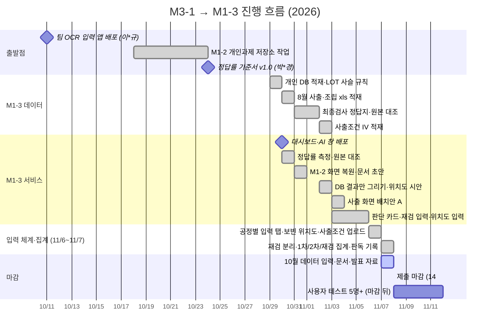

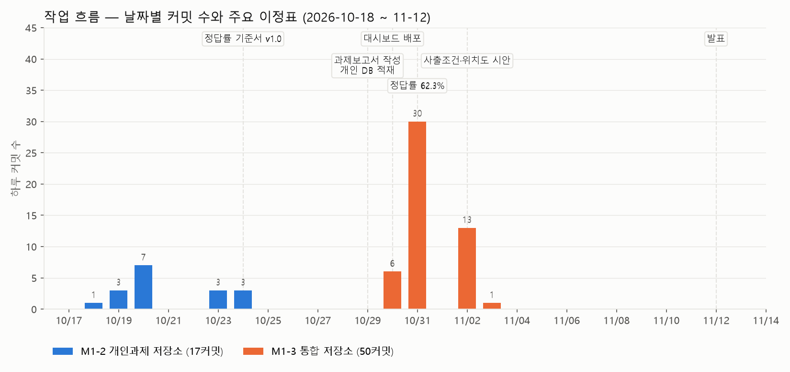

> 커밋 수 출처: `git log` (M1-2 저장소 10/18~10/24 17개, M1-3 저장소 10/30~11/7 102개 — 11/6 23개·11/7 12개 포함). 10/29 작업은 M1-3 첫 커밋(10/30)에 함께 들어갔습니다.

### 3-1. 시스템이 하는 일 (데이터 흐름)

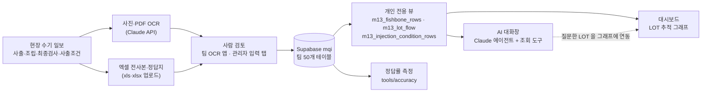

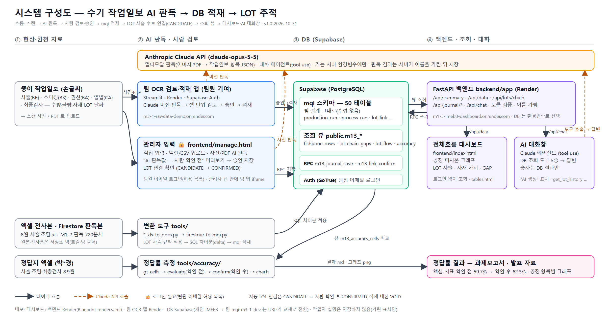

### 3-2. M3-1 단계 — OCR 판독과 정답률

**무엇을 했나.** 박*경이 9월 작업일보 원본을 Claude 로 판독했고(판독 A), 팀 기준서 v1.0 으로 정답률을 재는 규칙을 정했습니다. M1-3 에서는 정답지 엑셀과 개인 DB 적재값을 자동으로 맞춰 보는 측정기(`tools/accuracy/`)를 만들었습니다(10/30).

**어려웠던 점.** 첫 결과(확인 전 59.0%, 534칸, 10/30 초안)는 "정답지가 늘 맞다"는 가정 위에 있었습니다. 틀린 칸 219개를 원본 PDF 92쪽과 하나씩 대조하니 정답지 쪽 오류도 8건 있었습니다.

#### AI 판독 (OCR) — 담당: 박*경

| 작업 | 상태 | 산출물 | 메모 |
|---|:---:|---|---|
| 9월 작업일보 원본 판독 | ✅ | `M3-1_원본판독_9월_완성본.xlsx` | 판독 A (Claude) |
| fivedb(GPT) 매핑 판독 | 🟡 | `firedb 매핑반영.xlsx` | 판독 B — 확인 필요 |
| 사출조건표 사진 판독 | 🟡 | 모델별 엑셀 | YUDO 핫러너 컨트롤러 제외 |
| 최종검사 일보 판독 | ❓ | | 정답지 없음 |

#### 정답률 측정 — 담당: 박*경

| 작업 | 상태 | 메모 |
|---|:---:|---|
| 정답률 기준서 v1.0 | ✅ | `정답률_기준.md` (2026-10-24) |
| 정답지 ↔ 판독 맞춤 키 대응표 | 🟡 | 날짜·모델·공정·항목·주야·위치. M1-3 `tools/accuracy/`(정답지 칸 ↔ DB 뷰 `m13_accuracy_cells`)로 자동 맞춤 구현(10/30) |
| Claude 판독 정답률 계산 | ✅ | 확인 전 59.7% → 틀린 칸 219개 원본 PDF 대조 → **확인 후 62.3%**(10/31, 개인 DB 적재값 기준). `docs/정답률/결과_확인후_*.md` |
| fivedb 판독 정답률 계산 | ⬜ | |
| 공정별·항목별·모델별 분석 | 🟡 | 공정·항목·모델·월·작업일보별 표 자동 생성(`docs/정답률/결과_*.md`) |
| 대표 오류 사례 2~3건 | 🟡 | 원본 대조로 유형 집계: 값 없음·누락 92, 숫자 오독 84(8↔6, 7↔1), 자릿수(0 추가·누락) 9, 행 밀림 8, 헛판독 3 |

**정답률 결과 (2026-10-31, 틀린 칸 원본 PDF 대조 반영)**

측정 방법 (팀 `정답률_기준.md` v1.0)
- 작업일보의 **칸 하나 = 문항 하나**. 맞춤 키는 날짜 + 모델(IV/OV/HSV) + 공정 + 항목 + 주야. 정답지(회사 전산 엑셀 8·9월) ↔ 개인 Supabase `mqi` 적재값(AI 판독본 유래)을 자동 대조(`tools/accuracy/`).
- 정답률 = 일치 ÷ (일치 + 불일치 + 누락 + 헛판독). 빈칸, 전사본으로 적재한 값, 판독본이 없는 일보는 분모에서 제외.
- **확인 전** = 정답지를 그대로 정답으로 본 수치. **확인 후** = 틀린 칸 219개를 원본 PDF 92쪽과 하나씩 대조해 정답지 오류는 원본값으로 재판정하고, 판단 불가는 제외한 수치.

| 지표 | 확인 전 | **확인 후** | 비교 칸 수 |
|---|---:|---:|---:|
| **Claude 판독 정답률 (핵심: 생산수량·불량수량)** | 59.7% | **62.3%** | 531 → 520 |
| 생산 공정 전체 (자재 LOT 날짜·작업시간 포함) | 55.0% | 56.0% | 1,250 → 1,239 |
| fivedb 정답률 | — | — | 미측정 |
| 두 판독 일치율 | — | — | 미측정 |

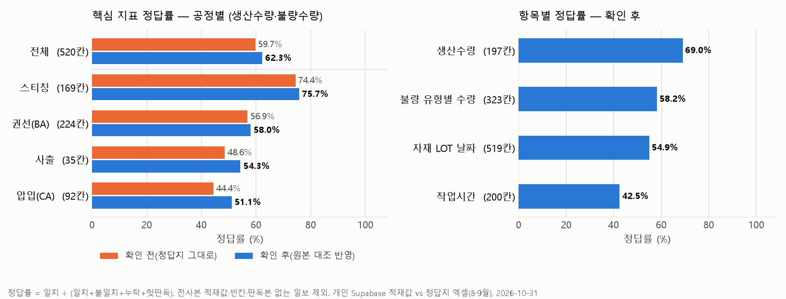

| 구분 | 확인 전 | 확인 후 | 비교 칸 |
|---|---:|---:|---:|
| 공정 · 스티칭 | 74.4% | **75.7%** | 169 |
| 공정 · 권선(BA) | 56.9% | **58.0%** | 224 |
| 공정 · 사출 | 48.6% | **54.3%** | 35 |
| 공정 · 압입(CA) | 44.4% | **51.1%** | 92 |
| 항목 · 생산수량 | 66.2% | **69.0%** | 197 |
| 항목 · 불량 유형별 수량 | 55.9% | **58.2%** | 323 |
| 항목 · 자재 LOT 날짜 | 54.9% | **54.9%** | 519 |
| 항목 · 작업시간 | 42.5% | **42.5%** | 200 |
| 월 · 8월 | 63.7% | **67.6%** | 247 |
| 월 · 9월 | 56.0% | **57.5%** | 273 |

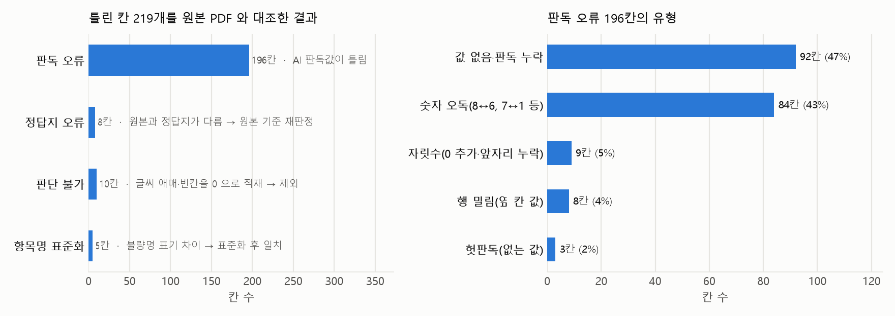

틀린 칸 219개의 원본 대조 결과: **판독 오류 196**(AI 판독값이 틀림) · **정답지 오류 8**(원본과 정답지가 다름, DB 가 맞는 경우 6건 포함 → 담당 박*경에게 전달) · **판단 불가 10**(글씨 애매, 빈칸을 0 으로 적재, 불량명만 있고 수량 없음) · **항목명 표준화 5**(스티칭 "전장" 칸을 다른 이름으로 적음 → 표준화 후 일치).

대표 오류 사례 (발표용)
1. **값 없음·판독 누락 (47%)** — 일보에 적힌 불량 수량(용접·비전1차·setup 등)을 통째로 읽지 않아 DB 에 행이 없음. 권선(BA) 9월 일보에서 집중 발생. 가장 큰 손실 원인.
2. **숫자 오독 (43%)** — 손글씨 8↔6, 7↔1, 3↔2 혼동. 5자리 생산수량의 한 자리가 바뀌면 칸 전체가 오답(예: 스티칭 생산수량 …8… → …6…).
3. **행 밀림 (4%)** — 불량 표에서 값이 한 칸 위·아래 항목으로 들어감(예: 비전1차 수량이 용접불량 칸에, 내경불량 수량이 저항불량 칸에). 한 번의 밀림이 누락 + 헛판독 두 개의 오답을 만든다.

한계·다음 단계
- 최종검사는 정답지에 검사수량이 없고 검사자별 집계 방식이 달라 헤드라인에서 제외(참고표만). 비교 규칙을 박*경과 합의해야 함.
- fivedb 판독본은 아직 비교하지 않음. 같은 파이프라인에 적재하면 두 판독 일치율까지 바로 산출 가능.
- 원본 대조로 확인된 값은 개인 DB 에 사람 확인값으로 정정했지만(10/31), 정답률 뷰는 AI 판독 원문을 계속 비교하므로 59.7%/62.3% 는 그대로 유지됨.
- 재계산 명령: `py tools/accuracy/evaluate.py` → `py tools/accuracy/confirm.py` → `py tools/accuracy/charts.py`.

### 3-3. M1-3 으로 옮긴 이유 — 개인 DB, 같은 스키마

| 이유 | 내용 |
|---|---|
| 팀 DB 쓰기 권한 없음 | 팀 `mqi-m3-1-dev` 는 조회만 가능. 적재·검증을 기다릴 수 없었음 |
| 이미 동작하는 화면 재사용 | 개인과제 M1-2 의 대화창·대시보드(피시본 그래프·모델 색)를 그대로 쓰고 DB 만 바꾸기로 함 |
| 나중에 키만 바꿔 전환 | 개인 `IMEB3 DB` 에 팀 마이그레이션을 **수정 없이** 적용 → `SUPABASE_URL`·키만 바꾸면 팀 DB 로 전환 |

**스키마 동일성 원칙** (`AGENTS.md`)
- 테이블·컬럼 이름, 자료형, 제약조건, 허용값, 트리거를 바꾸지 않는다. 팀 기준 SQL 은 고치지 않고 그대로 적용한다.
- 개인 프로젝트에만 필요한 것(뷰·권한)은 별도 마이그레이션 파일에 "개인 프로젝트 전용"으로 둔다.
- 새 테이블·컬럼이 필요하면 만들지 않고 팀 DB 담당(이*규)에게 제안할 내용으로 기록한다(예: 측정 유형 '초품' FIRST_ARTICLE).
- 검증 결과: 테이블 50+1, FK 152, CHECK 229 가 팀 기준과 같음.

### 3-4. 적재와 LOT 사슬

**무엇을 했나.** Firestore 판독 데이터를 팀 테이블 이름 그대로 바꾸는 변환기(`tools/firestore_to_mqi.py`, 720문서 → INSERT 4,097행)를 만들고, LOT 을 공정 순서대로 잇는 규칙을 정했습니다.

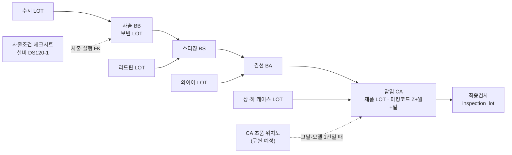

연결 규칙 (사용자 확인)
- 상위 공정 탐색 범위는 기준일 포함 **15일 전**까지(처음 7일로 잘못 잡았다가 수정).
- 권선 ← 스티칭: 일보의 보빈 날짜가 같은 것을 **모두** 후보(CANDIDATE)로 연결.
- CA 와 BA 는 같은 조립일보·같은 LOT. CA 의 투입은 BA 산출 LOT 하나만 잇는다.
- 자재는 홈 공정에 붙인다: 수지→사출, 리드핀→스티칭, 와이어→BA, 케이스→CA.
- 사슬 점검은 CA → 최종검사 연결까지 포함한다.

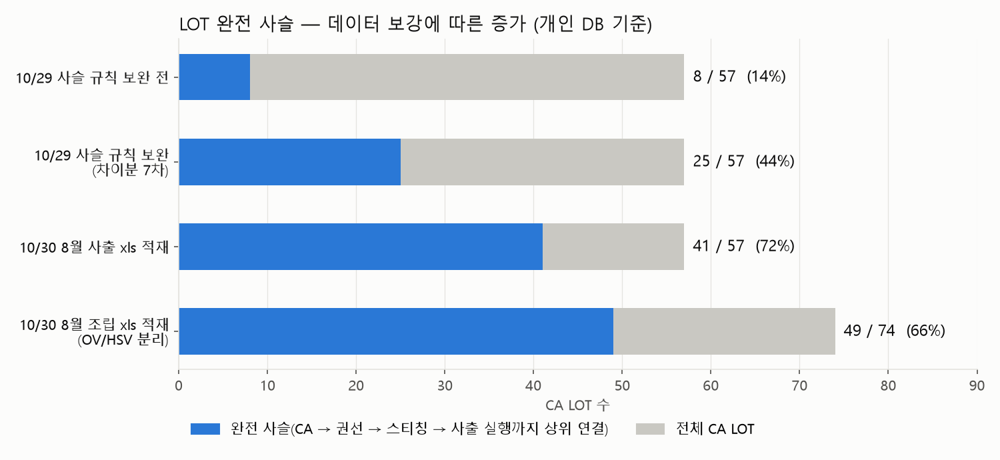

| 시점 | 한 일 | 완전 사슬 |
|---|---|---|
| 10/29 | 변환기 규칙 보완 전 | 8 / 57 |
| 10/29 | 15일 범위·보빈 날짜 매칭·자재 홈 공정, 차이분(delta) 7차 적용 | 25 / 57 |
| 10/30 | 8월 사출 일보가 Firestore 에 8건뿐 → xls 원천(18장)에서 23건 적재 | 41 / 57 |
| 10/30 | 8월 조립 xls 로 OV/HSV 합산 보류 구간을 모델별로 분리 | **49 / 74** |

#### 데이터·DB 세부 작업

| 작업 | 상태 | 산출물 | 메모 |
|---|:---:|---|---|
| Firestore 프로토타입 | ✅ | 개인 GitHub `M1-2`, CSV→엑셀 자료 | 데모 참고용 |
| 팀 DB 설계 (50개 테이블, 이름 규칙) | ✅ | Supabase `mqi` 스키마 | 팀 결정 사항 |
| 기존 데이터 ↔ 50개 테이블 매칭 | 🟡 | `mqi_스키마_매칭_별표후보_firedb 매핑반영.xlsx` | |
| 9월 적재 초안 | ✅ | `mqi_적재초안_9월.xlsx` | |
| LOT 관계 테이블 제안 | ✅ | `mqi_제안_LOT관계테이블.xlsx` | 팀원 협의 후 반영 |
| 자재·작업자 기준정보 | 🟡 | 직접 엑셀 작성 | 원본 확인 필요 |
| Firestore → `mqi` 변환기 | ✅ | `M1-3/tools/firestore_to_mqi.py` | 720문서 → INSERT 4,097행. 팀 테이블·컬럼 이름 그대로, LOT 연결은 CANDIDATE |
| 개인 Supabase(IMEB3) 적재 | ✅ | 팀 마이그레이션 수정 없이 적용(테이블 50+1, FK 152, CHECK 229 동일) | 8·9월 적재 완료, 차이분(delta) 7차까지 반영 |
| LOT 사슬 연결 규칙 | ✅ | `docs/사슬_*_20261029.md`, 뷰 `m13_lot_chain_gaps`·`m13_lot_flow` | 15일 범위, 보빈 날짜 매칭, 조견표 마킹코드(Z+월+일), 자재 홈 공정. 최신 기준 CA LOT 74개 중 완전 사슬 49개(49/74) |
| 최종검사 규칙 반영 | ✅ | `docs/검사규칙_및_LOT흐름표_20261029.md` | 전담 4명=2차, 신입·지원=1차, 재검 연결 43건, 검사자 이름 가림 |
| BA·CA 수량 차이 확인 | 🟡 | `docs/BA_CA_수량차이_원문확인_20261029.md` | 판독 오류 의심 3건 원본 PDF 확인 요청 중 |
| 팀 DB 실제 적재 | ⚠️ | | 팀 DB 쓰기 권한 없음. 개인 DB 검증 완료 → 이*규 승인 후 `SUPABASE_URL`·키만 바꿔 전환 |
| 8월 데이터 | 🟡 | `imeb3 *_8월_.xls`, Firestore 8월 판독분 | 사출·조립 8월 엑셀 전사본 적재 완료(10/30). 조립 엑셀로 OV/HSV 합산 보류 구간을 모델별로 분리 → CA LOT 57→74, 완전 사슬 49/74. 7월 사출 일보·PDF 원본 재확인 남음 |

### 3-5. 최종검사 — 규칙을 세우고, 추정을 걷어냄

**현장 규칙 (팀장 확인, 10/29).** 1차 검사는 신입·지원 검사자, 실제 검사 수량은 전담 4명이 한 2차 검사. 재검은 본검사에 연결(`inspection_run_link`). 검사자 이름은 가린 표시명만 DB 에 둡니다.

**진행 순서**

| 날짜 | 한 일 | 결과 |
|---|---|---|
| 10/31 | 최종검사 LOT 코드를 정답지와 대조 | 같은 행 306건 확인 표시, 정답지에 없는 코드 35건 무효, 누락 76건 입력 |
| 10/31 | 대시보드가 mqi 검사 연결을 원문 재해석으로 덮어쓰던 문제 수정 | CA 쪽 검사 LOT 33 → 453 |
| 10/31 | 정답지 'Lot No'(LOT:BOX) 로 LOT 별 검사수량 97건 반영 | 수량 미확인 34 → 7곳 |
| 10/31 | 월 글자를 못 읽은 마킹코드 41건을 "검사일에 가장 가까운 CA LOT"으로 후보 연결 | 검사 연결 CA LOT 51 → 55/74 |
| 11/2 | 위 추정 연결 중 미검증 10건을 원본 PDF 로 확인 → **맞은 것 1건** | 4건 정정, 6건 미연결. **추정 연결 금지** 원칙 확정 |
| 11/2 | 검사 LOT 이 CA 가 아닌 다른 공정 LOT 에 붙은 77건 정리 | 69건 CA LOT 재연결, 8건 미연결 |
| 11/2 | 9월 정답지 불일치 27건 원본 16쪽 대조 | 29행 채움, 4행 재연결, 1행 VOID, 4행 되돌림, 정답지 오류 2건 |
| 11/2 | 누락된 9/11·9/12 OV 조립일보를 서비스 사진 판독 → 원본 대조 → 저장 RPC 입력 | 사슬 깊이 4 확인 |

> 배운 점: 가까운 날짜로 "추정"한 연결은 대부분 틀렸습니다. 못 읽은 코드는 미연결로 두고, 원문·정답지·원본 PDF 근거가 있는 것만 연결합니다.

### 3-6. 대시보드 · AI 대화창 · 배포

**무엇을 했나.** 10/30 대시보드와 AI 대화창을 Render 에 배포했습니다. 10/31 새로 만든 탭 화면이 M1-2 에서 합의한 화면과 달라, M1-2 전체흐름 화면(피시본 그래프·모델 색 IV 검정/OV 노랑/HSV 파랑)을 그대로 복원하고 데이터만 `mqi` 뷰(`m13_fishbone_rows`)로 바꿨습니다. 11/2 에는 화면 코드에 남은 날짜별 보정값을 모두 지우고 **DB 조회 결과만 그리도록** 정리했습니다.

| 작업 | 담당 | 상태 | 메모 |
|---|---|:---:|---|
| DB 설계 (Supabase `mqi`) | 이*규 | ✅ | 50개 테이블, 이름 규칙 확정 |
| 백엔드 | 강*아 (M1-2 확장) · 이*규 | 🟡 | `M1-3/backend` FastAPI: 판독 업로드, 저장 RPC `m13_journal_save`, 조회 API, 채팅. 이*규 버전과 통합 협의 |
| 대시보드 (LOT 추적 그래프) | 강*아 (M1-2 확장) · 이*관 | 🟡 | `M1-3/frontend/index.html` 추적 그래프 + 자재 칩, `manage.html` 입력관리. 이*관 버전과 통합 협의 |
| 수기일보 정답지 작성·분석 | 박*경 | 🟡 | 사출 9월 정답지 있음, 조립 9월 확인 |
| 도메인 설계 | 팀장 | 🟡 | 공정·LOT 추적 흐름, LOT 관계 테이블 제안 |
| AI 대화창 | 강*아 (M1-2 확장) | 🟡 | Claude 에이전트 + `mqi` 조회 도구. "AI 생성" 표시, 질문 범위 확장 남음 |
| 스캔 업로드 → 판독 화면 | 강*아 · 박*경 | 🟡 | `M1-3` OCR 프롬프트(공정별 필수 항목) + `manage.html`. M3-1 Streamlit 검토 프로토타입(팀)과 역할 정리 필요 |
| 외부 접근 배포 | 이*규 (팀 OCR 앱) · 강*아 (대시보드) | 🟡 | 팀 OCR 앱 Render 배포(10/11)를 그대로 쓰고, 이력추적·대화창 대시보드는 별도 Render 서비스(10/30). 팀원 로그인 규칙은 팀 앱과 동일 |
| 관리자 입력 탭 (OCR 데이터 넣기) | 강*아 · 이*규 | 🟡 | 메인 대시보드는 로그인 없이 조회, "관리자 입력 🔒" 탭에서 팀 OCR 검토·적재 앱(Streamlit) 연결 + 보조 입력. 로그인은 팀 앱과 같은 Supabase Auth 허용 이메일 규칙 |
| CA 초품 핀 위치도 (A1-3 PosiDash 연동) | 강*아 | 🟡 | 시안 확정(11/2): A1-3 좌·우 핀 확대 그림 그대로, 판정 3단계(정상 ≤0.35·경계 ≤0.40·불량 >0.40, IV·OV·HSV 동일), 스케일 위치도 0.7 고정, 점은 모델색·불량은 X. 팀 표 `quality_check`·`measurement` 에 저장(테이블 추가 없음). 원천 파일 11/3 받아 구현 |
| 사출조건 시계열 (BB 클릭 화면 · 대화창 연동) | 강*아 | 🟡 | 사출조건 체크시트를 팀 표 그대로(`equipment`·`parameter_definition`·`process_setup_spec(_item)`·`parameter_observation`·`process_equipment_usage`) 적재, 실측→사출 실행 FK. 설비 DS120-1 한 대에서 IV·OV·HSV 가 겹치지 않음(팀장 확인) → 가로축=사출 실행 순서. 보빈 중량 SPEC 상자+실측 DOT, 1순위 사출압력·보압 / 2순위 전환위치·쿠션 / 3순위 온도, LOT 질문 시 그 LOT 을 만든 사출 실행 앞 4건·뒤 3건. IV 9장 적용(11/2), OV·HSV 11/3 |

배포·입력에서 고친 것
- 사진 OCR 이 400 오류로 실패 → 구조화 출력 스키마가 너무 큰 것이 원인 → JSON 텍스트 + 항목별 검증으로 바꿈. Render 에서 스티칭 PDF 판독 확인(10/31).
- 회사 작업일보 양식 xlsx 를 그대로 올리면 0건이던 문제 → 조립 BA/CA·스티칭·사출 시트를 읽는 파서 추가(10/31).
- frontend 만 바뀐 커밋이 Render 에 배포되지 않던 문제 → `render.yaml` buildFilter 추가, 화면에 배포 버전 표시(11/2).
- AI 생성 표시: 답변에 "AI(Claude)가 생성" 문구, 사진 판독 결과는 "AI 판독값 — 사람 확인 전".

### 3-7. 사출조건과 CA 위치도 (11/2 ~ 11/3)

**사출조건 (IV 9장 적재 완료).**

| 항목 | 내용 |
|---|---|
| 적재 | 조건 항목 59 · 기준 44(기준문서 S30420B1 의 기준 줄 허용범위) · 실측 621 |
| 설비 | DS120-1 한 대에서 IV·OV·HSV 사출(팀장 확인) → 설비 사용 기록 57건 CONFIRMED |
| 사출 실행 FK | 실측 508/621 연결 (9/23 은 사출 실행 기록이 없어 미연결) |
| 출처 | 시트·셀 위치를 팀 출처 테이블 사슬로 기록: `source_document`(탭) → `source_location`(엑셀 셀) → `extracted_field` → `field_review` → `field_provenance_link`, `source_run_link` |
| 탭 이름 | 엑셀 탭 이름 = 보빈(사출) LOT. 사출 화면 가로축은 날짜 대신 LOT 순서. 야간 행은 사람 확인 전(NEEDS_REVIEW) |
| 보빈 중량 SPEC | IV 11.0~11.6 / OV 12.0~12.6 / HSV 12.1~12.7 (M3-1 v0.50 출처, 팀장 확인으로 CONFIRMED) |
| 우선 인자 | 1 사출압력·보압 → 2 전환위치·쿠션 → 3 온도(노즐·H1·금형). 순서는 코드가 아니라 DB(`parameter_definition.description` JSON)에 둠 |
| 대화창 연동 | LOT 을 물으면 그 LOT 을 만든 사출 실행 앞 4건·뒤 3건을 그래프로 (AI 도구 `get_injection_conditions`) |

**화면 배치 결정 (11/3).** 배치 시안 A~D 를 비교해 **A 교체형**(공정 단계를 누르면 오른쪽 카드가 바뀌고 대화창은 왼쪽 고정)을 골랐습니다. 카드 맨 위에 '📍 추적 중 LOT' 띠를 두어 사출→스티칭→권선→압입→최종검사 칩 중 지금 보는 공정을 '현재 위치'로 표시합니다.

| A 교체형 (선택) | A2 현재 위치 표시 — 사출 |
|---|---|
| 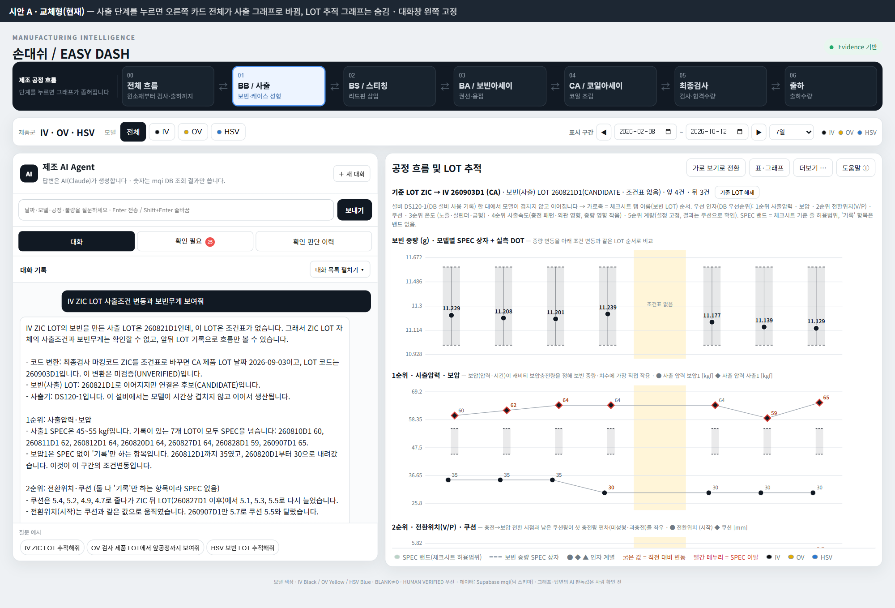 | 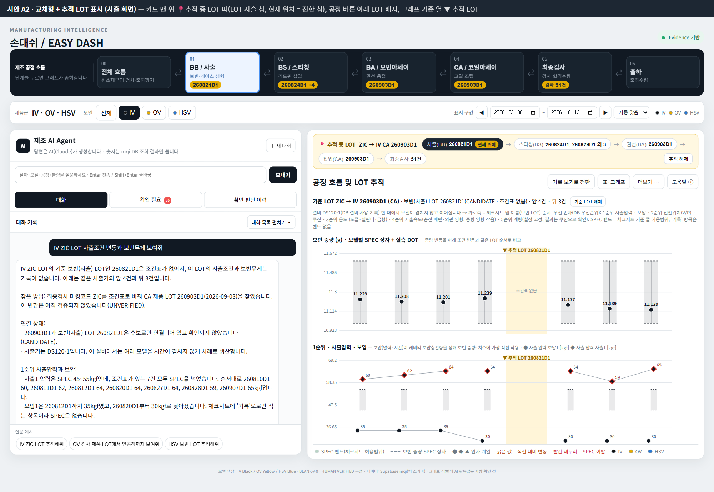 |

비교한 다른 배치안 (B 상하분할 · C 전폭 드릴다운 · D 서랍형 · A2 전체 흐름)

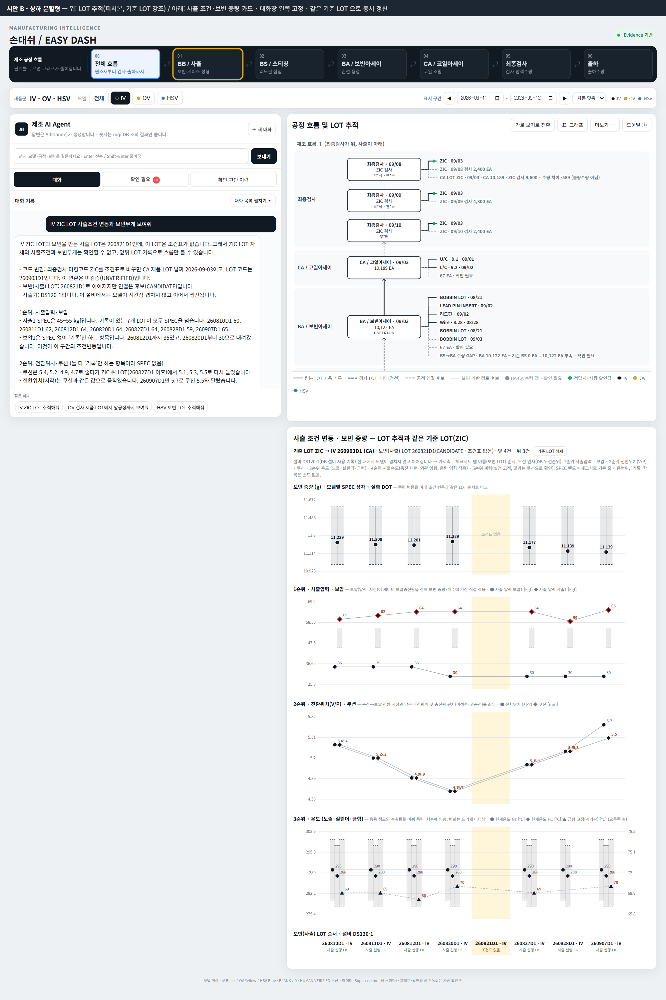
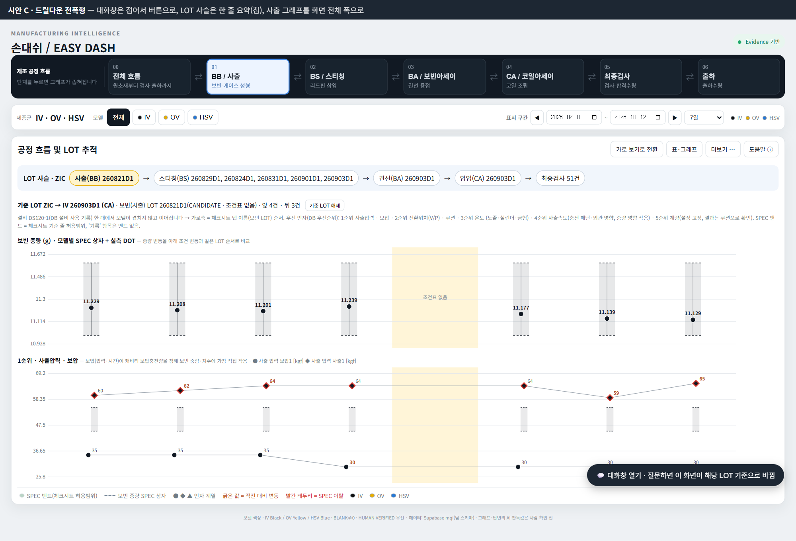
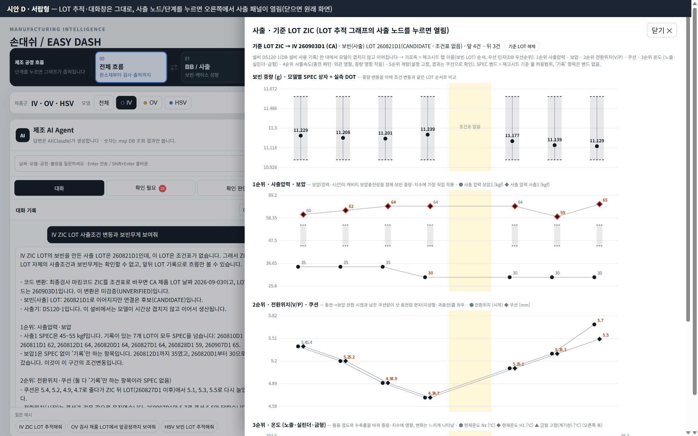
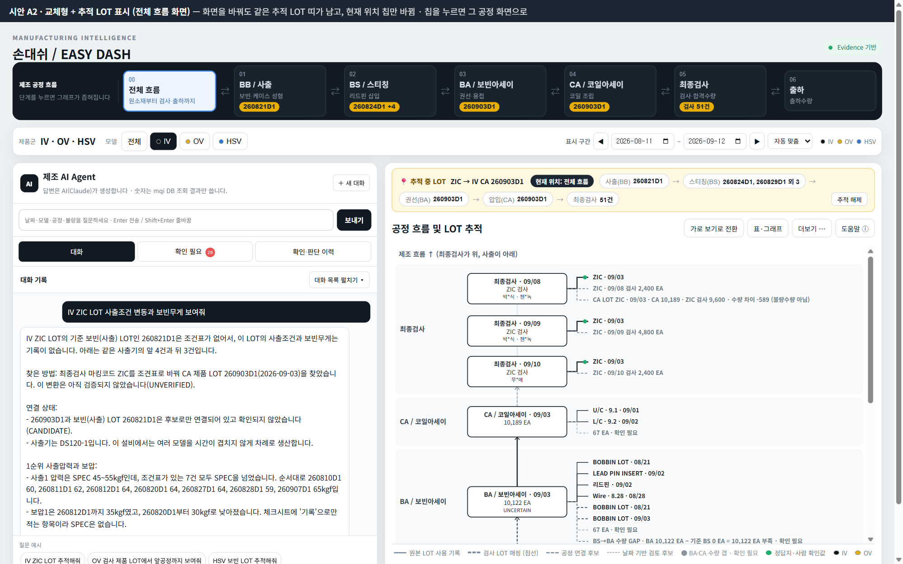

**관찰 — 현장 확인 필요.** IV 사출1 압력 실측(59~66)이 모든 LOT 에서 SPEC 50±5 상한을 넘습니다. 일정한 폭으로 넘기 때문에 실제 불량이라기보다 기준값 또는 기록 칸 해석 문제일 수 있습니다. 기준값을 현장에서 확인해야 합니다. 또 8/20 보압 35→30 변경 뒤 보빈 중량이 줄어드는 추세가 보입니다(원인 확인 전).

**CA 초품 핀 위치도 (시안 확정, 구현 예정).** A1-3(PosiDash) 그림을 그대로 쓰고, 판정 3단계(정상 ≤0.35 · 경계 ≤0.40 · 불량 >0.40), 스케일은 위치도 0.7 고정, 점은 모델 색·불량은 X. 새 테이블 없이 팀 표 `quality_check`·`measurement` 에 저장합니다.

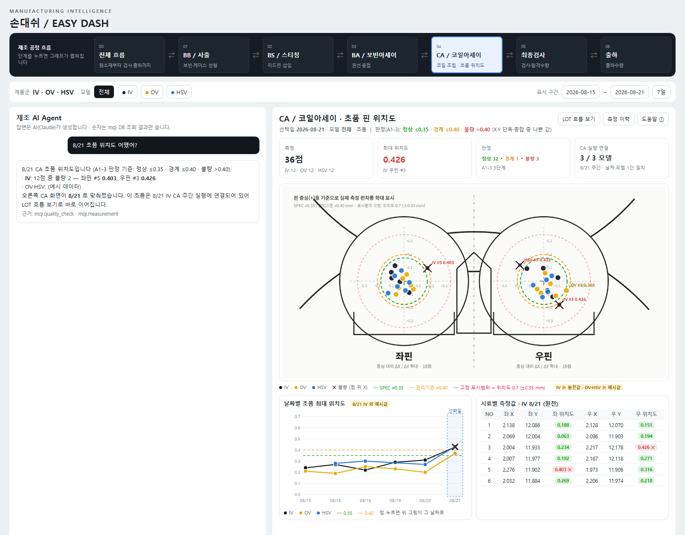

### 3-8. 사용자 테스트 준비

| 준비물 | 상태 | 내용 |
|---|:---:|---|
| 테스트 시나리오 v1 | ✅ | 10/30 작성 |
| 테스터 안내문 (공개) | ✅ | `docs/사용자테스트/테스터_안내문.md` — 현재 화면 기준 과제 4개 + 선택 1, 설문, 동의 문구, 진행자 체크리스트 (10/31) |
| 섭외 메시지 | ✅ | 메신저·이메일·회사 확인 한 줄 (로컬) |
| 테스터 섭외 | 🟡 | 사내 품질·생산·전산 담당자 + 제조 경험 지인, 예비 1명 포함 6명 목표 |
| 테스트 실시 | ⬜ | **제출 마감(11/8 14:00) 뒤 진행**하기로 결정(11/7). 결과는 이 보고서 5-3 에 추가 |

### 3-9. 입력 체계 정리 — 공정 순서 탭, 사람 판독 기록, 재검 분리 (11/6 ~ 11/7)

**무엇을 했나.** 데이터를 매일 넣을 수 있도록 관리 화면을 공정 순서로 다시 짰고, 품질 기록(사출조건·보빈/CA 위치도·재검사)을 모두 같은 화면에서 넣어 팀 표에 FK 로 연결되게 했습니다. 테이블 구조는 바꾸지 않았고(팀 스키마 동일 원칙), 필요한 것은 개인 전용 뷰·RPC(`supabase/migrations/20261106*`·`20261107*`)로 두었습니다.

| 영역 | 무엇이 바뀌었나 | 팀 표·FK |
|---|---|---|
| 관리 화면 탭 순서 | ① 사출조건 체크시트 ② 보빈 위치도 ③ 사출 ④ BS ⑤ 조립(BA·CA) 작업일보 ⑥ CA 초품 위치도 ⑦ 최종검사(작업일보·재검사) │ 보조: 직접 입력·엑셀·사슬 보완·연결 확인·CRUD 이력·판독 기록 | — |
| 작업일보 = Claude 사진 판독 기본 | 탭에서 고른 공정을 Claude 에 힌트로 주고, 다른 공정 일보면 경고. 여러 쪽 PDF(최종검사 6~11쪽)는 **한 쪽씩 나눠 읽고 합침** | 기존 저장 RPC `m13_journal_save` |
| 고치기 = 사람 판독 기록 | 미리보기에서 고친 칸마다 `AI 판독값 → 사람 값`을 출처 기록(`remark.source.human_edits`)에 남김(이름 칸은 가림). 저장 줄은 화면 아래 고정 | 출처 기록 + CRUD 이력 |
| 사출조건 체크시트 업로드 | IV·OV·HSV 같은 양식 엑셀을 그대로 올림(사진 탭은 건너뛰고 셀 값만, 4.6MB 0.1초). 탭 이름 = 보빈 LOT → 같은 LOT 의 사출 실행에 FK | `parameter_observation` → `process_run`, 출처 사슬 |
| 보빈 초품 위치도 | 캐비티 16 × 좌·우, CA 위치도처럼 **복사·붙여넣기**(제목 줄째 또는 숫자 줄만), ㈜/(야) → BB LOT D1/N1. 대시보드 사출 화면 [LOT 흐름 · 사출조건 · 보빈 위치도], 캐비티 A~P 표기 | `quality_check`(보빈 초품) → 사출 실행, `measurement` |
| CA 초품 위치도 | 여러 날 한 번에 붙여넣기, 특이사항(생산 이벤트로도), **같은 날 재측정**(측정 순번, 수정 전·후 겹쳐 보기), 하루/기간 보기·측정일 모델 색, 시료 번호 표시. '확인 필요'에서는 제외(경계·불량도 산포도 데이터) | `quality_check.check_sequence` |
| 재검사 분리 | 최종검사 일보 판독에서 **비고란의 재검**(검사 내용·LOT·BOX·수량·검사자)을 따로 빼서 같은 화면에서 고쳐 저장. 마킹코드로 CA LOT 을 찾고, 없으면 'CA 작업일보 미확인' LOT 을 만들어 **바로 FK**(본검사와 같은 규칙). 못 읽은 마킹만 미연결 | `inspection_run`(재검) · `inspection_lot` → CA LOT · `inspection_run_link`(본검사 → 재검) · `quality_finding` |
| 입력 목록 | 위치도·재검사·사출조건·보빈 목록 공통: 입력 최신순 30건 + 더 보기, 날짜 기간 거르기, 방금 입력 표시, 한국 시각 | — |

**검사 구분 집계 규칙 (팀장 결정 11/7).**

| 구분 | 의미 | 집계 |
|---|---|---|
| 1차 | 검사 훈련·신입·타 제품 검사자 지원·연습 | LOT 검사 수량에 **합치지 않음**(따로 표시) |
| 2차 | 통상 본검사 | **LOT 검사 수량·불량 = 2차만** |
| 재검 | 불량 이슈로 검사 완료품을 다시 검사 | 재검 LOT 별 수량·불량·불량률 **따로**. 이슈 뒤에는 본검사에서도 같은 불량을 검출하므로 '재검 불량 이슈 ↔ 이후 2차 본검사' 표로 나란히 비교(종합 판단은 사람) |

- 일보에 차수 표기가 없으면 2차(본검사)로 저장하도록 바꾸고, 10/01~10/05 미기재 22건을 2차로 정정했습니다.
- 대시보드 LOT 흐름: 최종검사 합계는 본검사만, 재검은 '재검(합계 제외)' 상자로 따로. LOT 옆 BOX 수, **재검된 LOT 은 빨간색 + 재검에서 추가로 나온 불량 유형·수량**(LOT 에 안 나뉜 재검은 'nLOT 범위').
- 예: IV L/C 찍힘 이슈(9/23~) 재검 38,400개 중 173개(0.45%), 이후 2차 본검사 96,010개 중 같은 불량 45개(0.047%), 이슈 전 2차 517개.

### 3-10. 판독 실행 기록 — 문서 종류별 토큰·판독 시간

11/7 부터 관리 화면에서 판독할 때마다 **문서 종류·모델·입력/출력 토큰·판독 시간·읽은 항목 수·성공 여부**를 팀 표 `extraction_run`(+ 출처 사슬)에 자동으로 남깁니다(관리 화면 '판독 기록' 탭, 뷰 `m13_ai_calls`). 엑셀 판독(사출조건·보빈 위치도)은 Claude 를 부르지 않아 토큰이 0 입니다.

<!-- 판독기록표:시작 — 11/8 데이터 입력 뒤 관리 화면 '판독 기록' 탭의 표로 채움 -->
| 문서 | 방식 | 모델 | 횟수 | 평균 입력 토큰 | 평균 출력 토큰 | 평균 판독 시간(초) | 평균 읽은 항목 |
|---|---|---|---:|---:|---:|---:|---:|
| 사출 작업일보 | Claude 이미지 | claude-opus-5-5 | | | | | |
| BS 작업일보 | Claude 이미지 | claude-opus-5-5 | | | | | |
| 조립 작업일보 | Claude 이미지 | claude-opus-5-5 | | | | | |
| 최종검사 작업일보 (PDF 1쪽) | Claude 이미지 | claude-opus-5-5 | | | | | |
| 사출조건 체크시트 | 엑셀 칸 판독 | — | | 0 | 0 | | |
| 보빈 위치도 엑셀 | 엑셀 칸 판독 | — | | 0 | 0 | | |
<!-- 판독기록표:끝 -->

- 시험 판독 참고값(11/7, 기록 집계에서는 제외): 최종검사 일보 PDF 1쪽 — 입력 8,168 / 출력 1,671 토큰, 14.7초. 현미경 재검 일보 1쪽 — 9,521 / 1,420 토큰, 16.6초(재검 2건 분리). 사출조건 체크시트 OV 11탭 — 0.42초(790칸).
- 비용: 대시보드 판독은 서버의 **Anthropic API 키로 호출해 토큰 사용량만큼 별도 과금**됩니다(Claude Pro 구독과 별개).

---

## 4. 어려움과 해결

| # | 문제 | 원인 | 해결 | 결과 수치 |
|---|---|---|---|---|
| 1 | 팀 DB 에 적재할 수 없음 | 팀 DB 쓰기 권한 없음 | 개인 `IMEB3 DB` 에 팀 마이그레이션을 수정 없이 적용, 스키마 동일성 원칙 | 테이블 50+1·FK 152·CHECK 229 동일. 전환은 이*규 승인 대기 |
| 2 | LOT 사슬이 거의 끊김 | 탐색 범위 7일, 같은 날 해석 오류, 자재 위치 혼동 | 15일 범위, 보빈 날짜 동일 모두 매칭, 자재 홈 공정 규칙 | 완전 사슬 8 → 25 / 57 |
| 3 | 8월 사출 LOT 이 추적에 없음 | 통합 CSV 에 8월 사출 일보가 8건뿐 | 원천 xls(18장) 찾아 23건 적재 | 25 → 41 / 57 |
| 4 | OV/HSV 가 합산돼 모델 구분 불가 | 판독본에서 합산 일보 보류 | 8월 조립 xls 로 모델별 분리 | CA LOT 57 → 74, 완전 사슬 49/74 |
| 5 | 다시 적재하면 기존 행과 충돌 | 삭제 금지 규칙 | 차이분(delta) SQL 만 적용, 사라진 행은 VOID | 7차까지 적용, 이력 보존 |
| 6 | 정답률이 낮게 나옴 | 정답지도 틀릴 수 있음 | 틀린 칸 219개를 원본 PDF 92쪽과 대조 | 59.7% → 62.3%, 정답지 오류 8건 |
| 7 | 사진 OCR 400 오류 | 구조화 출력 스키마가 너무 큼 | JSON 텍스트 + 항목별 검증 | Render 판독 성공 (약 18초) |
| 8 | 대시보드가 M1-2 와 다르게 바뀜 | 새 탭 화면을 따로 만듦 | M1-2 화면 복사 + 데이터만 mqi 뷰 | 피시본 그래프·모델 색 유지 |
| 9 | 그래프에 검사 연결이 안 보임 | 화면이 원문 재해석으로 mqi 연결을 덮어씀 | 재해석 제거, DB 연결 사용 | CA 쪽 검사 LOT 33 → 453 |
| 10 | 검사 수량 미확인 칸 | 검사 기록에 LOT 별 수량 없음 | 정답지 'Lot No'(LOT:BOX)로 97건 반영 | 미확인 34 → 7곳 |
| 11 | 검사가 엉뚱한 LOT 에 붙음 | "가까운 날짜" 추정 연결 | 원본 확인 → 추정 금지, 미연결 처리 | 미검증 10건 중 1건만 맞음 → 4 정정·6 미연결, 77건 → 69 재연결 |
| 12 | 날짜마다 화면 숫자를 따로 고침 | 프론트 고정 보정값 | 보정 삭제, 사실은 DB 에서 정정 | 검사 LOT 수량 11건 DB 정정 (BOX×480+낱개) |
| 13 | 검사 기록의 모델을 고칠 수 없음 | 팀 스키마 복합 FK (ON UPDATE RESTRICT) | 올바른 모델로 새 기록 + 기존 기록 VOID | 9/11·9/12 OV 기록 4장 대체 |
| 14 | 화면만 고친 커밋이 배포 안 됨 | `render.yaml` rootDir 이 backend | buildFilter 추가, 배포 버전 표시 | 이후 frontend 커밋 약 2분 뒤 자동 배포 |
| 15 | 사출 조건을 어느 실행에 붙일지 불명 | 설비·주야 정보 부족 | 팀장 확인: DS120-1 단일 설비, 겹치지 않음 | 설비 사용 57건 CONFIRMED, 실측 508/621 FK |
| 17 | 대시보드에 10/19 이후 위치도가 안 보임 | Supabase 조회가 한 번에 1000행까지만 돌려줘 조용히 잘림 | 서버 조회를 1000행씩 끝까지 읽도록(모든 조회 공통) | 위치도 1,188행 전부 표시 |
| 18 | 최종검사 PDF 판독 실패 | 6~11쪽을 한 번에 보내 시간·출력 길이 제한 초과 | 쪽수만 먼저 확인 → 한 쪽씩 판독해 합침, 쪽마다 기록 | 1쪽 약 15초, 실패한 쪽만 다시 |
| 19 | LOT 검사 합계에 재검·1차가 섞임 | 그래프가 1차만 빼고 재검은 더함, 차수 미기재를 1차로 저장 | 집계 규칙(2차만 합산, 재검 따로) 화면·뷰·AI 공통 적용, 미기재 → 2차 | ZIO 합계 24,480 → 16,800(본검사) + 재검 7,680 따로 |
| 20 | 재검을 비고 캡처로 따로 올려야 함 | 재검 판독기가 별도 | 최종검사 일보 판독이 비고의 재검을 바로 분리 | 캡처·재업로드 단계 없음 |
| 21 | 판독 메모에 사람 이름 노출 | Claude 의 불확실 메모 | 검사자·작업자 이름을 메모에서도 가림 | 저장·화면 모두 가린 이름 |
| 16 | (M1-2 단계) 데이터 API 오류 | Firestore 일일 사용량 한도 초과 (10/24) | M1-2 에서는 로컬 CSV 대체 경로·일일 스냅샷 도구 추가 | Supabase 전환과의 관계는 ❓ 확인 필요 |

### 이슈·위험 관리

| # | 이슈 | 영향 | 조치 | 상태 |
|---|---|---|---|:---:|
| 1 | 외부 접근 배포 방식 미정 (고정 IP·전산팀 없음) | 필수 요건 미충족 위험 | Render(무료) + Supabase 로 방식 확정. 팀 OCR 앱(이*규)·대시보드 모두 Render. 무료 플랜은 15분 유휴 시 잠듦 → 발표 전 깨우기. 팀 DB 통합 후 최종 구성 결정 | 🟡 |
| 2 | 실사용자 5명 테스트가 제출 마감 전에 끝나지 않음 | 필수 요건 4 | 안내문·섭외 메시지 준비 완료. **제출 마감(11/8 14:00) 뒤 진행**하기로 결정(11/7), 결과는 보고서에 추가 | 🟡 |
| 3 | 팀 DB(`mqi-m3-1-dev`) 쓰기 권한 없음 | 적재 검증 지연 | 개인 Supabase `IMEB3 DB`(mqi 동일 스키마)에서 적재·검증 완료. 이*규 승인 후 키만 바꿔 전환 | 🟡 |
| 4 | 최종검사 정답지 없음 | 정답률 범위 제한 | 비교 불가로 집계, 발표에서 한계로 명시 | ✅ 방침 확정 |
| 5 | 로컬 폴더 접근 오류 (Windows 업데이트 문제) | Claude 작업 지연 | Windows 업데이트 후 재시작, 또는 파일 직접 첨부 | 🟡 |
| 6 | 작업자 이름 등 개인정보 | AI 윤리 요건 | DB 에는 가린 표시명만, OCR 프롬프트는 이름 미기록. 방침 문서 `docs/개인정보_처리방침.md` 작성(10/31), 테스터 동의 문구 포함 | ✅ |
| 7 | 사출1 압력이 모든 LOT 에서 SPEC 50±5 상한 초과 | 그래프가 계속 "이상"으로 보임 | 기준값·기록 칸을 현장에서 확인 | ❓ |

---

## 5. 현재 진척도

### 5-1. 영역별 진척도

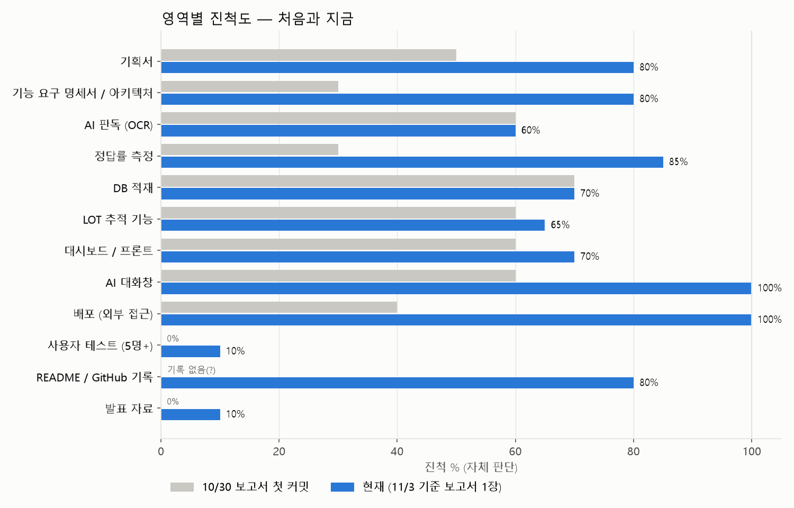

| 영역 | 상태 | 진척 | 한 줄 메모 |
|---|---|---:|---|
| 기획서 | 🟡 | 80% | `docs/기획서.md` 초안 v0.1(10/31). 사용자 테스트 결과·일정 확정 후 마무리 |
| 기능 요구 명세서 / 아키텍처 | 🟡 | 80% | `docs/기능요구명세서.md`(FR 24·NFR 9), `docs/시스템아키텍처.md` v0.2 + 그림 구성도 `docs/img/시스템아키텍처_구성도.png`(10/31). 팀 검토 남음 |
| AI 판독 (OCR) | 🟡 | 60% | 박*경 — 9월 판독본 완성, 사출조건표 판독 진행 중 |
| 정답률 측정 | 🟡 | 85% | Claude 판독 확인 전 59.7% → 확인 후 62.3%(10/31, 그래프·오류 유형 포함). fivedb 비교·최종검사 규칙 합의 남음 |
| DB 적재 | 🟡 | 70% | 개인 Supabase(IMEB3, 팀 스키마 동일)에 8·9월 판독본 + 8월 전사본 적재 완료, 사출조건 IV 9장 적재(11/2), 9/23 IV 재검 1건(11/3). 남은 것: OV·HSV 사출조건(전사본 미제공), CA 초품 위치도 27일(대시보드 입력·테스트 과제 6). 팀 DB 전환은 쓰기 권한 대기 |
| LOT 추적 기능 | 🟡 | 65% | 사출→스티칭→BA→CA→최종검사 사슬 + 자재 LOT 가지 DB 뷰·그래프·추적 화면 동작. 완전 사슬 CA LOT 51/76(11/6). 남은 끊김은 7월 일보 미수록분 |
| 대시보드 / 프론트 | 🟡 | 90% | 강*아 — M1-2 전체흐름 화면(피시본 그래프·모델 색) 그대로 + 데이터만 `mqi`. 표 화면(`tables.html`)·관리 화면 별도. 사출(BB) 조건 화면·배치안 A·추적 중 LOT 띠(11/2~11/3). CA 초품 핀 위치도 화면(11/3). **사람 판단 카드**(확인 필요 탭, 11/3): 판단을 팀 표에 저장하고 LOT 에 연결, AI 제안·일치율. 관리 화면: 최종검사 재검사 탭(비고 캡처 AI 읽기·다중 LOT·삭제), 작업일보 이미지 입력 보강(파일명 날짜·작업자 이름 가림·중복 저장 방지)(11/3). 그래프 점 클릭으로 판단 카드 열기는 남음. 팀장 직접 점검(그래프 정확성) 및 이*관 버전과 통합 방식 협의 남음 |
| AI 대화창 | ✅ | 100% | 강*아 — M1-2 챗봇을 `mqi` 조회 도구로 연동(FastAPI `/api/chat`, Claude 에이전트), AI 생성 표시 완료. 질문 범위 확장 완료: 사출조건 도구(11/2)·위치도 도구(11/3), 대화 질문의 LOT 으로 그래프 연동. 사용자 테스트 피드백은 요건 4 에서 관리 |
| 배포 (외부 접근) | ✅ | 100% | 팀 OCR 입력 앱은 이*규가 Render 에 배포(10/11, https://m3-1-rawdata-demo.onrender.com). 이력추적·대화창 대시보드도 Render 에 올림(10/30, https://m1-3-imeb3-dashboard.onrender.com, 개인 DB 기준). 외부 접속·팀원 로그인 동작 → 요건 충족. 팀 DB 전환·최종 구성은 남은 일 6-1 의 5번으로 따로 관리 |
| 사용자 테스트 (5명+) | ⬜ | 15% | **필수 요건** — 안내문·섭외 메시지·과제 6 준비. **제출 마감 뒤 진행**(11/7 결정) |
| README / GitHub 기록 | 🟡 | 80% | 공개 저장소 README 를 결과물 양식(개요·역할·스택·실행·결과·바로 열기 링크)으로 정리(10/31). 팀 저장소 README 정리 남음 |
| 발표 자료 | ⬜ | 10% | 정답률 표·그래프 2장·대표 오류 사례 3건 준비됨. pptx 초안 v0.1(17장, 실명 포함이라 로컬 전용)에 시연 동영상·테스트 결과 채울 것 |

> 진척 %는 대략적인 자체 판단입니다. 11/3 대시보드 70→75%(판단 카드), 11/6 75→80%(재검사 탭·이미지 입력 보강 완료), 11/7 80→90%(공정별 입력 탭·보빈 위치도·사출조건 업로드·재검 분리·검사 구분 집계·판독 기록), 사용자 테스트 10→15%(과제 6 준비).

### 5-2. 필수 요건 체크리스트

| # | 필수 요건 | 상태 | 관련 진척 | 근거·메모 |
|---|---|:---:|---:|---|
| 1 | 생성형 AI / AI Agent가 서비스 핵심 기능 | ✅ | 판독 70% · 대화창 100% | Claude API 판독(작업일보 4종·재검 분리, 관리 화면에서 매일 입력) + Claude 에이전트 대화창(DB 조회 도구) |
| 2 | 필수 기술 요소 2개 이상 | ✅ | 3개 동작 | 멀티모달(사진·PDF 판독) + 자동화 워크플로우(판독 → 사람 고치기 → 저장 RPC → FK) + AI Agent(대화창) |
| 3 | 서비스 **외부 접근 가능하게 배포** | ✅ | 100% | 팀 OCR 입력 앱(이*규, Render 10/11) + 이력추적·대화창 대시보드(Render 10/30). 둘 다 Supabase, 외부 접속·로그인 확인. 팀 DB 전환은 별도 남은 일 |
| 4 | **실사용자 5명 이상** 테스트·피드백 | ⬜ | 15% | 안내문 `docs/사용자테스트/테스터_안내문.md`(과제·설문·동의·진행자 체크리스트)와 섭외 메시지 준비. **제출 마감(11/8 14:00) 뒤 진행**, 결과 추가 예정 |
| 5 | GitHub 버전 관리 기록 | 🟡 | 80% | 팀 `neoinkyu/M3-1`(비공개) + 개인 통합 `solarjina-geena/M1-3`(공개, 과제보고서 포함, 커밋 50개·팀원 PR 포함) — 커밋 꾸준히 남기기 |
| 6 | AI 생성 콘텐츠임을 사용자에게 명시 | ✅ | 100% | AI 창 "답변은 AI(Claude)가 생성" 문구·"AI:" 접두, 사진 판독 결과 "AI 판독값 — 사람 확인 전" 표시 (M1-3 화면) |
| 7 | 개인정보 수집 시 동의·안전 관리 | ✅ | 100% | `docs/개인정보_처리방침.md` v1.0(10/31): 실명 미저장(DB 점검 22명 전원 가림·미가림 0건), 외부 전송 범위, 테스터 동의 문구, 보존·삭제. 회사 측 확인·회원가입 차단은 방침 9장 '남은 일' |
| 8 | 팀 3~5인, 역할 분담 | ✅ | 100% | 4명: 팀장(도메인·AI 대화창) / 이*규(DB·백엔드) / 이*관(대시보드) / 박*경(정답지·AI 판독·정답률) |

> "관련 진척"은 5-1 영역 % 를 옮긴 것입니다(요건 3=배포, 4=사용자 테스트, 5=README/GitHub). ✅ 항목만 100% 로 표기했습니다.

### 5-3. 최종 결과물 체크리스트

| # | 결과물 | 포함해야 할 내용 | 상태 | 파일·위치 |
|---|---|---|:---:|---|
| 1 | 기획서 | 문제 정의, 타겟 사용자, AI 활용 방식, 기술 접근, 일정 | 🟡 | `docs/기획서.md` 초안 v0.1 |
| 2 | 기능 요구 명세서 | 기능(FR)·비기능(NFR) 요구사항, AI 활용 명세 | 🟡 | `docs/기능요구명세서.md` 초안 v0.1 |
| 3 | 시스템 아키텍처 | 구성도 (스캔 → AI → DB → 대시보드/채팅) | ✅ | `docs/시스템아키텍처.md` v0.2 + 그림 `docs/img/시스템아키텍처_구성도.png`(SVG 원본 포함). 팀 검토 후 확정 |
| 4 | AI 서비스 | 판독 + DB 적재 + LOT 추적 화면 | 🟡 | `M1-3/backend`, `M1-3/frontend` (개인 DB 기준 동작) |
| 5 | 사용자 테스트 결과 | 테스터 수, 피드백, 반영 내용 | ⬜ | |
| 6 | GitHub 저장소 | 소스 코드 + 문서 + 커밋 기록 | 🟡 | 팀 `neoinkyu/M3-1` · 개인 통합 https://github.com/solarjina-geena/M1-3 |
| 7 | README.md | 개요, 팀원 역할, 기술 스택, 실행 방법, 결과 | 🟡 | `M1-3/README.md` 결과물 양식으로 정리 완료(10/31, 배포·문서 바로 열기 링크 포함). 팀 저장소 README 정리 필요 |
| 8 | 발표 자료 | 문제·해결 과정, AI 활용 근거, 피드백·개선, OCR 정답률 | ⬜ | |
| 9 | 배포 URL | 외부에서 접속 가능한 주소 | ✅ | 대시보드 https://m1-3-imeb3-dashboard.onrender.com · 팀 OCR 앱 https://m3-1-rawdata-demo.onrender.com |

### 5-4. 과제 목표별 "설명할 수 있어야 하는 것"

발표·질의응답 대비용. 각 항목에 우리 답변 근거를 채워 갑니다.

| # | 설명해야 할 것 | 우리 답변의 근거 | 준비 |
|---|---|---|:---:|
| 1 | 실제 사용자 문제 정의와 AI 해결 방식 | 수기 일보 → LOT 추적 불가 문제, AI 판독으로 해결 (1-2, 3-1) | 🟡 |
| 2 | 생성형 AI API / Agent를 서비스에 통합한 방법 | Claude API 판독 → mqi DB 적재 흐름, 대화창 에이전트의 DB 조회 도구, LOT 질문 → 그래프 연동 (3-6, 3-7) | 🟡 |
| 3 | 프롬프트·RAG 등 AI 기법을 쓴 근거 | 판독 프롬프트 설계, "검토필요" 표시 방식 | ⬜ |
| 4 | 노코드 자동화 + Python 조합 경험 | ❓ 사용 도구 정리 필요 (Firestore 프로토타입, Python 판독 등) | ⬜ |
| 5 | 사용자 피드백 수집·개선 과정 | 사용자 테스트 후 작성 | ⬜ |
| 6 | 본인 역할·기여·협업 과정 | 역할 분담표 + 기여 출처 구분표(M1-2 확장 vs M3-1) + 커밋 기록 + 어려움과 해결 표(4장) | 🟡 |

---

## 6. 남은 일과 일정

### 6-1. 제출 마감(11/8 14:00)까지

| # | 할 일 | 상태 |
|---|---|:---:|
| 1 | 10월 작업일보 입력(③ 사출 · ④ BS · ⑤ 조립 → ⑦ 최종검사·재검) — 관리 화면 Claude 판독 + 고치기 | 🟡 |
| 2 | 확인 항목: 9/23 IV 재검 6쪽(ZI?·ZIX·불량 232/222), 10/29 위치도 1차·재측정 다시 입력, 보빈 주/야(IV 8/21·HSV 8/25), 확인 필요 38건 | 🟡 |
| 3 | 화면 마무리: AI 대화창 점검, 모니터 배율(125~150%) 맞춤, 공정별 메인 대시보드 보조 그래프 | 🟡 |
| 4 | 판독 기록 비교표([3-10](#3-10-판독-실행-기록--문서-종류별-토큰판독-시간)) 채우기, 보고서·README·발표 자료 최종본 | 🟡 |
| 5 | 최종 커밋·푸시, 배포 확인(Render 깨우기), 제출 링크 점검 | ⬜ |

### 6-2. 마감 뒤

| # | 할 일 |
|---|---|
| 1 | **실사용자 5명+ 테스트**(필수 요건 4) — 결과·피드백을 5-3 과 발표 자료에 추가 |
| 2 | 팀 DB 전환·최종 구성 협의(이*규 승인), 이*관 버전 통합 |
| 3 | 9/10 OV 수지 LOT(DB 08.24 vs 원본 08.25), fivedb 정답률, 정답지 오류 8건 전달, 사출1 압력 기준값 현장 확인, 7월 사출 일보 확보 |

이전 일정·할 일 기록 (11/3 ~ 11/6)

**11/3 할 일 — CA 초품 위치도 (A1-3 연동, 데이터 입력·평가는 작업일보 관리 화면 활용)**

| # | 할 일 | 상태 |
|---|---|:---:|
| 1 | 위치도 원천 파일 받기 (A1-3 양식, 날짜·모델별 초품 측정) | ✅ 8·9월 Coil Ass'y 초품 위치도 2개 파일 — 데이터 있는 하루치 27일(IV 12·OV 10·HSV 5, 8/21~9/03) |
| 2 | 개인 프로젝트 전용 뷰 마이그레이션 — X/Y 로 위치도·3단계 판정 계산, 원천 기재값 대조 | ✅ 뷰 `m13_position_checks`, 기준값(X 2.1·Y 12.0·SPEC ⌀0.35·관리기준 ⌀0.40·표시범위 ±0.35)은 DB 등록(`tools/position_spec.sql`) |
| 3 | 원천 적재 → `quality_check`(초품) + `measurement`(좌·우 핀 X/Y). CA 실행 연결은 그날·모델 1건일 때만 | 🟡 **대시보드 입력 방식으로 평가하며 적재**(팀장 결정 11/3): 원천 블록을 그대로 붙여넣는 입력기로 바꾸고 27일치 전부 미리보기 시험 — 모델·날짜 자동 인식, 원천 OK/NG 와 다른 칸 0. 27일 중 21일은 저장 시 CA 실행 연결, 6일은 그날 CA 실행 기록 없어 미연결. 실제 입력은 사용자 테스트 과제 6 + 팀장 |
| 4 | 대시보드 CA 클릭 화면 — 핀 확대 그림(위치도 0.7 고정)·날짜별 추이·시료별 표 | ✅ 교체형, '초품 위치도 / LOT 흐름 보기' 전환, 추적 LOT 의 CA LOT 날짜로 자동 선택 |
| 5 | AI 대화창 위치도 조회 도구 추가, 날짜·모델 기준으로 CA 화면 연동 | ✅ 도구 `get_position_checks` |
| 6 | 작업관리자 화면(`manage.html`)에 A1-3식 붙여넣기 입력 탭 (미리보기·중복 경고·저장, 삭제는 VOID) — 데이터 입력과 평가를 이 화면에서 | ✅ 'CA 초품 위치도' 탭(DB 기준으로 미리보기 판정, 같은 날 재저장은 '기존 기록 바꾸기'로 VOID) |
| 7 | 팀 DB 담당(이*규)에게 측정 유형 '초품'(FIRST_ARTICLE) 추가 제안 기록 | ✅ 제안서 작성(로컬 `docs/팀제안_초품_측정유형_20261103.md`), 전달 남음 |
| 8 | CRUD 이력: 팀 감사 테이블 `mqi_audit.row_change` 를 공정 단계(사출·스티칭·권선·압입·최종검사·원본·공통)로 풀어 저장 1회 단위로 보기 | ✅ 뷰 `m13_crud_history` + 관리 화면 'CRUD 이력' 탭. 누가 = `web:로그인(가림)`, 무엇을 = `[공정] 입력경로 · 요약` 으로 통일 |

**11/3 할 일 — 사람 판단 기록 (대시보드 '확인 필요' 탭 판단 카드)**

첫 버전 범위는 '좁게 시작'(팀장 결정 11/3): 자동 연결 후보(CANDIDATE) 1,500여 건은 목록에 올리지 않고, 사람이 꼭 봐야 하는 34건부터.

| # | 할 일 | 상태 |
|---|---|:---:|
| 1 | 확인 필요 뷰 `m13_review_queue` — 판독값 확인 필요 2 · 판독 불가 검사 LOT 31 · 생산 이벤트 1 · 초품 위치도 경계/불량(입력되면) | ✅ 34건 |
| 2 | 판단 저장 RPC `m13_judgment_save` — 팀 표 허용값만 사용(판독값 = `field_review` 새 행, 검사 LOT 연결은 같은 모델 CA 제품 LOT 일 때만, 삭제는 VOID). 근거·AI 제안은 대상 행 remark JSON, 사유 `[공정] 판단:<결정> · 대상 · 근거` | ✅ 네 가지 경로 시험 저장 후 되돌림으로 확인, 틀린 LOT 코드 거절 확인 |
| 3 | 판단 이력 뷰 `m13_judgment_log` — 팀 감사 테이블에서 판단 1건 = 1행, LOT·결정·근거·AI 일치 여부 | ✅ |
| 4 | 대시보드 판단 카드(`frontend/judgment.js`) — 결정 버튼, 정정값·CA LOT 입력, 사유 코드, 메모 5~500자(이메일·전화 형태 차단), 근거 이미지 3개(SHA-256 해시만, 이미지 5MB·PDF 20MB), 같은 종류 일괄 판단 20건, 로그인은 관리 화면과 공유 | ✅ |
| 5 | AI 제안(판단 카드 버튼, 사용자당 분당 5회)과 대화창 도구 `get_review_queue` · `get_judgment_history` · `find_similar_judgments` — 제안만, 결정은 사람 | ✅ |
| 6 | 그래프 NG·SPEC 이탈 점 클릭으로 카드 열기, 이미지 'AI로 읽기'(1,568px 사본) | ⬜ 다음 버전 |
| 7 | 실제 판단 입력(34건)과 AI 제안 일치율 집계 → 발표 자료 | ⬜ 팀장 |

**11/3 추가 — 최종검사 재검사(일보 비고란) 입력 (관리 화면 '최종검사 재검사' 탭)**

재검사 = 이미 최종검사한 LOT 에서 불량을 추가로 가려내는 작업. 팀 표에 이미 칸이 있어 스키마 변경 없이 FK 로 연결합니다.

| # | 할 일 | 상태 |
|---|---|:---:|
| 1 | 저장 구조 확인 — `inspection_run`(REINSPECTION·TARGETED, 육안/현미경) · `inspection_lot`(대상 CA 제품 LOT FK) · `inspection_run_link`(본검사 → 재검, TARGETED_REINSPECTION) · `quality_finding`(FINAL_DEFECT, 불량 유형 FK) | ✅ |
| 2 | RPC `m13_reinspection_save` — 재검 1건에 LOT 여러 개(실제 9/23 IV 비고: 마킹 10개·합계 38,400EA·불량 173EA), 같은 모델 CA LOT·그 LOT 을 검사한 본검사만 허용, 불량은 LOT 1개면 그 LOT 에·여러 개면 재검 합계로(나누지 않음), 같은 날 같은 LOT 중복은 막고 '기존 기록 바꾸기'로만 교체 | ✅ 되돌림 시험 |
| 3 | 삭제 RPC `m13_reinspection_void` — 재검·대상 LOT·본검사 연결·불량을 함께 VOID(사유 5자 이상, CRUD 이력 [최종검사]) | ✅ |
| 4 | 비고란 캡처 → AI 읽기(`/api/reinspection/read-image`, 긴 변 1,568px 사본만 전송, 분당 5회) — 마킹코드는 조견표로 CA LOT 날짜, 그날 LOT 이 하나일 때만 자동 선택, 못 읽은 글자는 사람이 고름 | ✅ 9/23 원본으로 10개 마킹·BOX·합계·불량 모두 정확히 읽음 |
| 5 | 비고에 LOT·모델이 없을 때 모델 → LOT(최종검사 받은 CA LOT 목록) → 본검사 직접 선택, '본검사 전부' 연결 옵션 | ✅ |
| 6 | 기존 판독 적재 재검 4건 정리(9/23 IV 2건은 LOT 미연결·불량 없음 → 새로 입력 후 삭제, OV 9/27 'Z?O' 가 260915D1 에 붙어 있음 → 원본 확인) | ⬜ 팀장 |

**11/3 할 일 — 사출조건 OV·HSV 추가 (팀장이 데이터 확인 후 제공)**

| # | 할 일 | 상태 |
|---|---|:---:|
| 1 | OV·HSV 사출조건 체크시트 받기 (사진 폴더 `1공장 사출조건표 사진/IMEB3 OV·HSV` 의 전사본) | ⬜ |
| 2 | 양식(칸 위치) 대조 후 `tools/injection_conditions_to_mqi.py` 로 적재 — 기준 줄 허용범위 = SPEC, 모델별 기준문서 번호. 시트·셀은 출처 테이블(`tools/injection_conditions_provenance.sql`)로, 탭 이름 = 보빈 LOT | ⬜ |
| 3 | `tools/injection_conditions_link_fk.sql` 재실행 → 실측을 OV·HSV 사출 실행에 FK (작업일자+주야 유일 일치) | ⬜ |
| 4 | 보빈 중량 SPEC(OV 12.0~12.6 / HSV 12.1~12.7, M3-1 v0.50 출처) 기준문서와 대조 | ✅ 팀장 확인으로 CONFIRMED (11/2 밤) |
| 5 | 사출 화면·대화창에서 OV·HSV LOT 질문으로 앞 4건·뒤 3건 그래프 확인 (모델 색 IV 검정 / OV 노랑 / HSV 파랑) | ⬜ |
| 6 | 사출1 압력 SPEC 50±5 기준값 현장 확인 (전 LOT 상한 초과) | ⬜ |

---

## 7. 변경 이력

| 날짜 | 내용 |
|---|---|
| 2026-10-24 | 정답률 기준서 v1.0 작성 |
| 2026-10-29 | 과제보고서 최초 작성 (미션 분석, 체크리스트, 진척도) |
| 2026-10-29 | 팀원 및 역할 추가 (이*규·이*관·박*경), 배포 담당 반영 |
| 2026-10-29 | 팀장 역할 반영 (도메인 설계, AI 대화창) — 팀 4명 |
| 2026-10-29 | AI 판독(OCR)·정답률 측정 담당 박*경 지정 |
| 2026-10-29 | 배포 담당에서 박*경 제외 → 배포 담당자 미정 |
| 2026-10-30 | 팀장 이름(강*아) 기입, 기여 출처 구분표 추가(M1-2 확장 vs M3-1 팀원). 개인 통합 작업 폴더 M1-3 명시 |
| 2026-10-30 | 10-29 M1-3 결과 반영: 개인 DB 적재·LOT 사슬·최종검사 규칙·대화창·대시보드 진척 갱신, AI Agent 기술 요소 ✅ |
| 2026-10-30 | 배포 준비(강*아): Render Blueprint, Supabase Auth 팀원 로그인(허용 이메일), 관리자 입력 탭(팀 OCR 앱 연결 + 보조 입력), AI 생성 표시. 배포 진척 0→40%, 필수 요건 3·6 갱신 |
| 2026-10-30 | 이력추적·대화창 대시보드 Render 배포(https://m1-3-imeb3-dashboard.onrender.com, 팀 OCR 앱 배포와 별도), GitHub 공개 저장소 solarjina-geena/M1-3 첫 푸시(이름 가림·이메일 비공개·과제보고서만 공개). 당시 진척률은 추후 정리하기로 함 |
| 2026-10-30 | 8월 사출작업일보 엑셀 전사본 적재(개인 DB). LOT 완전 사슬 25→41/57 |
| 2026-10-30 | 8월 조립작업일보 엑셀 전사본 적재(OV/HSV 보류 구간 해소). CA LOT 74, 완전 사슬 49 |
| 2026-10-30 | OCR 정답률 측정 자동화(정답지 엑셀 ↔ 개인 DB). 확인 전 초안: 핵심 지표 59.0%(534칸). 사용자 테스트 시나리오 v1 작성 |
| 2026-10-31 | 틀린 칸 219개 원본 PDF 대조 완료(판독 오류 196·정답지 오류 8·판단 불가 10). 확인 후 핵심 정답률 62.3%(520칸), 스티칭 불량명 표준화 반영 |
| 2026-10-31 | 6-3 정답률 결과를 표·그래프 2장·대표 오류 사례로 정리. 기획서·기능 요구 명세서·시스템 아키텍처 초안 v0.1 작성(`docs/`). 1장 진척 % 갱신 |
| 2026-10-31 | 최종검사 LOT 코드를 정답지(최종검사일보 정답지 엑셀)와 대조해 DB 보정: 정답지와 같은 행 306건에 확인 표시, 정답지에 없는 코드 35건 무효, 누락 76건 입력(출처 '정답지'). 그래프·답변에 정답지·사람 확인값 초록 ● 표시. 대시보드에서 제품 상표명 제거(모델명 IV/OV/HSV 만 표기), 글자 크기 확대 |
| 2026-10-31 | 최종검사 마킹코드의 월 글자를 못 읽은 행(Z?X) 41건을 조견표 일 글자 + 검사일에 가장 가까운 CA LOT 으로 후보 연결(linked_by=month_inferred). 검사 기록이 붙은 CA LOT 51→55/74 |
| 2026-10-31 | 원본 대조로 확인된 AI 판독 오류를 개인 DB 에 사람 확인값으로 정정(출처 remark corrected_by): 생산수량 60건, 공정 불량 정정 46·보완 입력 81·헛판독 무효 8. 정답률 뷰는 AI 판독 원문을 계속 비교하므로 59.7%/62.3% 유지. 전체흐름 그래프 세로 나무 보기 추가 |
| 2026-10-31 | 대시보드를 개인과제 M1-2 전체흐름 화면(피시본 그래프·모델 색·AI 대화창) 그대로로 교체, 데이터만 `mqi`(뷰 `m13_fishbone_rows`). 기존 표 화면은 `tables.html` 로 유지. 관리자 입력 탭 로그인 '세션 만료' 오류 수정 |
| 2026-10-31 | README와 과제보고서 진척 현황·일정 동기화. LOT 완전 사슬 수치를 최신 CA LOT 74개 중 49개(49/74)로 통일 |
| 2026-10-31 | 사진 OCR 입력 오류 수정(Anthropic 구조화 출력 스키마 크기 400 → JSON 텍스트+검증), OCR 미리보기 로그인 필수, Render 판독 확인. README 를 결과물 양식(개요·역할·스택·실행·결과·바로 열기 링크)으로 재작성 |
| 2026-10-31 | 개인정보 처리 방침 v1.0 작성(`docs/개인정보_처리방침.md`, 공개). 필수 요건 7·이슈 6 ✅, NFR-3 ✅. 사용자 테스트 기록표에 동의 칸 추가 |
| 2026-10-31 | 시스템 구성도 그림 작성(`docs/img/시스템아키텍처_구성도.png`·SVG): 현장 → AI 판독·사람 검토 → Supabase mqi → FastAPI·대시보드·AI 대화창, 배치 도구·정답률 흐름, Claude API 호출 표시. 결과물 3 ✅ |
| 2026-10-31 | 사용자 테스트 준비: 테스터 안내문(공개, 현재 화면 기준 과제 4개+선택 1·설문·동의 문구·진행자 체크리스트)과 섭외 메시지 초안(메신저·이메일·회사 확인 한 줄, 로컬). 요건 4 진척 0→10%, 이슈 2 ⚠️→🟡 |
| 2026-10-31 | 대시보드 최종검사 LOT 연결 미반영 수정(M1-2 원문 재해석 함수가 mqi 연결을 덮어씀 → CA 쪽 검사 LOT 33→453). 최종검사 정답지 'Lot No'(LOT:BOX) 로 LOT 별 검사수량 97건을 개인 DB inspection_lot 에 출처와 함께 반영(검사 기록·CA LOT FK 유지) → 대시보드 수량 미확인 34→7곳. 불일치 46건·중복 의심은 로컬 목록으로 원본 확인 대기 |
| 2026-11-02 | 최종검사 정답지 불일치 중 9월 27건을 원본 PDF 16쪽과 대조(8월 원본은 미제공으로 제외). 원인은 한 쪽에 여러 열이 있는 양식에서 정답지 장이 다른 열과 짝지어진 것. LOT 별 수량 29행 채움·LOT 코드 판독 오류 4행 CA LOT 재연결·중복 1행 VOID·잘못 넣은 4행 되돌림. 정답지 오류 2건 발견. 모델 오류 2건·검사자/열 누락 2건은 기록 구조 수정이 필요해 보류 |
| 2026-11-02 | Render 가 frontend 만 바뀐 커밋을 배포하지 않던 문제(rootDir: backend) → render.yaml buildFilter 추가. 최종검사 화면 LOT 가지 표시 수정 배포 |
| 2026-11-02 | 최종검사 LOT 연결 원칙 정비: 월 글자를 못 읽은 검사 LOT 을 '검사일에 가장 가까운 CA LOT'으로 추정 연결했던 미검증 10건을 원본 PDF 로 확인(맞음 1건) → 4건 정정, 6건 미연결. 검사 LOT 이 CA 가 아닌 권선·스티칭·사출 LOT 에 붙어 있던 77건 → 같은 번호 CA LOT 69건 재연결, 8건 미연결. 입력 시 조견표(Z+월+일)는 세 글자가 모두 읽힌 경우에만 날짜로 풀고 '?' 가 있으면 미연결(추정 금지) |
| 2026-11-02 | 누락된 9/11·9/12 OV 조립(2차 라인) 일보를 서비스 사진 판독 → 원본 대조 정정(압입 16,991→18,991 등) → 저장 RPC 로 입력, 사슬 깊이 4 확인. 원본이 OV 인데 IV 로 들어간 검사 기록 4장은 팀 스키마 FK 규칙상 모델 수정이 불가해 OV 새 기록으로 대체하고 기존 기록·하위 행 VOID, 근거 없는 재검 연결 4건 VOID. 서비스 입력 시 압입(CA)이 같은 조립일보의 BA LOT 을 투입으로 갖도록 수정 |
| 2026-11-02 | 그래프는 DB 조회 결과만 그리도록 정리: 화면 코드의 날짜별 고정 보정(9/10 IV 권선 33,580→3,358, 9/11 OV LOT 이름, 원본 근거 없는 9/10 ZIJ 초품 상자, 원문 재해석 날짜 추정 LOT)을 삭제하고 DB 값·연결만 사용. 9/17 최종검사 원본 대조로 검사자가 잘못 묶인 기록 1장을 박*식 2장으로 대체, 누락된 이*진 둘째 열(6,720) 추가. 검사 LOT 수량을 BOX×480+낱개 규칙으로 통일(DB 11건 정정). 1차검사(훈련) 수량이 합계에 들어가던 화면 정규식 오류 수정 |
| 2026-11-02 | CA 초품 핀 위치도(A1-3 PosiDash) 연동 검토·시안 확정: 팀 표 `quality_check`·`measurement` 로 저장 가능(구조 변경 없음), A1-3 판정 3단계·좌우 핀 확대 그림 유지, 스케일 위치도 0.7 고정, 모델색 점·불량 X. 6-4 작업 행과 11/3 할 일 추가 |
| 2026-11-02 | 사출조건 체크시트(IV 9장) 개인 DB 적재: 조건 항목 59·기준 44(S30420B1 기준 줄 허용범위)·실측 621. 설비 DS120-1(팀장 확인: IV·OV·HSV 단일 설비, 시간상 겹치지 않음) 사용 기록 57건 CONFIRMED, 실측 508건을 사출 실행에 FK(9/23 은 사출 실행 기록 없어 미연결). 보빈 중량 모델별 SPEC 등록. 사출(BB) 클릭 화면: 보빈 중량 SPEC 상자+실측 DOT, 1~3순위 조건(사출압력·보압 / 전환위치·쿠션 / 온도) SPEC 밴드, 가로축=데이터가 있는 사출 실행 순서. 대화창 LOT 질문 → 사출 실행 앞 4건·뒤 3건 그래프 연동(AI 도구 get_injection_conditions). OV·HSV 는 11/3 |
| 2026-11-02 | 사출조건 시트·셀 위치를 팀 출처 테이블 사슬(source_location·extracted_field·field_review·field_provenance_link·source_run_link)로 이전, 엑셀 탭 이름 = 보빈 LOT(사출 화면 가로축 = LOT 순서, 날짜 표시 없음), 보빈 중량 SPEC CONFIRMED, 우선 인자 순서를 DB JSON 으로. 사출 화면·AI 답변의 설비명을 DB 설비 사용 기록에서 읽도록 수정. 팀원 PR #2(스티칭 불량명 통합·모델별 그래프 색상 통일) 병합 |
| 2026-11-03 | 사출 화면 배치 시안 A~D 비교 → A 교체형 선택. 카드 맨 위 '추적 중 LOT' 띠(사출→스티칭→권선→압입→최종검사 칩, 현재 위치 표시), 사출 그래프 폭 맞춤. 관찰: 사출1 압력이 모든 LOT 에서 SPEC 50±5 상한 초과 → 기준값 현장 확인 필요 |
| 2026-11-03 | 과제보고서를 처음(M3-1 팀 계획)부터 M1-3 까지 한 흐름으로 재구성: 과제 개요 → 출발점 → 단계별 진행 → 어려움과 해결 → 현재 진척도 → 남은 일 → 변경 이력. Mermaid 일정·데이터 흐름·LOT 사슬 그림, 새 그래프 3장(`docs/img/진행_1~3_*.png`), 사출 시안 이미지 삽입 |
| 2026-11-03 | CA 초품 핀 위치도를 대시보드에 반영: 뷰 `m13_position_checks`(판정은 DB 기준값으로 계산), 저장 RPC `m13_position_save`(같은 날 재저장은 이전 기록 VOID, CA 실행은 그날·모델 1건일 때만 연결), CA 클릭 화면(핀 확대 그림·추이·시료표, 표시범위 고정), AI 도구 `get_position_checks`. 작업일보 관리 화면에 'CA 초품 위치도'(붙여넣기·미리보기 판정) 와 'CRUD 이력'(공정 단계별, 저장 1회 단위) 탭 추가, 모든 저장의 actor·사유를 `web:로그인(가림)` / `[공정] 입력경로 · 요약` 으로 통일 |
| 2026-11-03 | 진척도 갱신: AI 대화창 70→100%(질문 범위 확장 완료 — 사출조건·위치도 도구, 대화 LOT → 그래프 연동), 외부 배포 60→100%(외부 접속·로그인 동작으로 요건 3 충족). 팀 DB 전환·최종 구성은 남은 일로 분리 |
| 2026-11-03 | 사람 판단 기록 첫 버전: 확인 필요 34건 뷰·판단 저장 RPC·판단 이력 뷰, 대시보드 판단 카드(AI 제안·일괄 판단·이미지 해시), 대화창 판단 도구 3개. 대시보드 진척 70→75%. 초품 측정 유형 팀 제안서 작성 |
| 2026-11-03 | CA 위치도를 대시보드 입력으로 평가하도록 준비: 관리 화면 입력기가 A1-3 원천 블록(제목·9칸·빈 양식 줄)을 그대로 읽고 모델·날짜 자동 채움, 미리보기에서 원천 OK/NG 대조(27일치 시험 불일치 0), 대시보드 CA 화면에 '초품 위치도 입력' 링크, 테스터 안내문 과제 6(입력→판정→판단 카드)·설문 6 추가 |
| 2026-11-03 | 최종검사 재검사(일보 비고란) 입력 탭 추가: 팀 표 4개(inspection_run·inspection_lot·inspection_run_link·quality_finding)에 FK 로 저장(스키마 변경 없음), 재검 1건 다중 LOT, 비고란 캡처 AI 읽기(마킹코드→CA LOT), 모델·LOT·본검사 직접 선택, 중복 차단·삭제(VOID) |
| 2026-11-03 | 작업일보 이미지 입력을 관리 화면 확장(B안)으로 결정·보강: 파일명 날짜 우선(없으면 AI 판독, 달력 보완), 작업자 이름도 검사자처럼 가린 표시명만 worker·worker_assignment 에 FK 저장, BA 보빈 날짜는 기존 변환기 규칙(15일 안 같은 보빈 스티칭 LOT)으로 연결, 같은 일보 중복 저장 방지('기존 기록 바꾸기'로만 VOID 후 재저장), 저장 함수 공개 실행 권한 차단. 9/10 실제 일보 3장(5건)으로 기존 LOT·FK 재사용 확인(되돌림 시험). 재검 입력에 미연결 마킹 줄·파일명 날짜 추가, 9/23 IV 5쪽 재검 입력 |
| 2026-11-06 | 진척도·일정 갱신: 한눈에 보기 11/6 기준, 완전 사슬 51/76, 필수 요건 ✅4·🟡3·⬜1, 대시보드 75→80%, 사용자 테스트 10→15%(진행 중·결과 0건), 남은 확인 항목(9/23 재검 6쪽, 9/10 수지 LOT, 확인 필요 35건) 추가. README 진척 현황 동기화 |
| 2026-11-06 | 관리 화면 위치도 입력 개선(여러 날 붙여넣기·특이사항·같은 날 재측정·입력 목록), 대시보드 날짜 선택 통일(위쪽 표시 구간 하나, ◀▶ = 기록 있는 날·다음 LOT), 조회 1000행 잘림 수정, 확인 필요 탭(종류 칩·확인·정정 버튼)·위치도 제외, 재검을 본검사 합계에서 분리, LOT 기록 누락 검사 LOT 남기기 |
| 2026-11-06 | 관리 화면 '사출조건 체크시트'(IV·OV·HSV 엑셀 업로드 → 사출 실행 FK)·'보빈 위치도'(캐비티 16 × 좌우, BB LOT FK, 대시보드 사출 화면) 탭, 입력 목록 최신순 30건·기간 거르기 |
| 2026-11-07 | 관리 화면을 공정 순서 탭으로(③ 사출 ④ BS ⑤ 조립 작업일보 = Claude 판독 기본, ⑦ 최종검사 작업일보·재검사 한 탭). 고치기를 사람 판독 기록으로 저장, 여러 쪽 PDF 한 쪽씩 판독, 비고 재검 자동 분리, 재검도 'CA 작업일보 미확인' LOT 으로 바로 FK. 검사 구분 집계 규칙(1차 훈련 제외·2차 본검사 합산·재검 따로)과 재검 불량 이슈 비교표, LOT 흐름에 BOX·재검 LOT 빨간색·추가 불량. 판독 실행 기록(토큰·시간·모델) 자동 저장과 '판독 기록' 탭. 대시보드 공정별 보기 단추(LOT 흐름 먼저). 제출 마감 11/8 14:00 확정, 사용자 테스트는 마감 뒤 |
