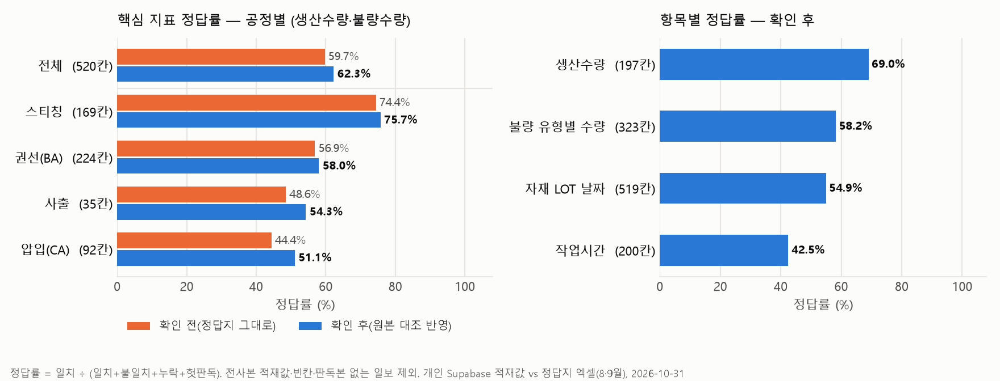
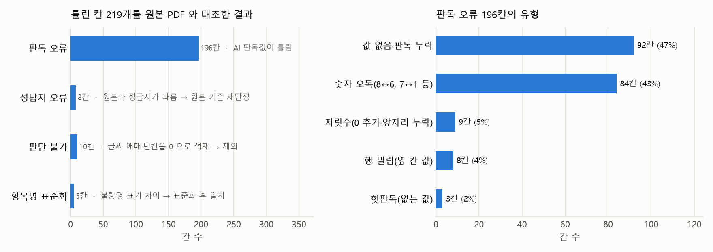

# M3-1 Final Project 과제보고서

> 수기 작업일보 AI 판독 → DB 적재 → LOT 추적 서비스
> 이 문서는 진행하면서 계속 업데이트하는 **살아 있는 보고서**입니다. 맨 아래 [변경 이력](#9-변경-이력)에 날짜별로 기록합니다.

| 항목 | 내용 |
|---|---|
| 과정 | 코디세이 AI 네이티브 (5개월) — Final Project (자율 주제) |
| 팀 저장소 | `neoinkyu/M3-1` (비공개) |
| 로컬 작업 폴더 | 팀 저장소 복사본 `D:\코디세이\M3-1` / **개인 통합 작업 `D:\코디세이\M1-3`** (개인과제 M1-2 의 대화창·대시보드를 그대로 가져와 DB 만 `mqi` 로 바꿔 확장) |
| DB | Supabase `mqi-m3-1-dev` / `mqi` 스키마 |
| 마감 | **2026-11-12** (발표: 노트북 연결 시연 + OCR 정답률 제시) |
| 최종 수정 | 2026-10-31 |

### 팀원 및 역할

| 이름 | 역할 | 담당 업무 |
|---|---|---|
| 이*규 | DB / Backend | DB 설계(Supabase `mqi` 스키마), 백엔드, 대시보드 연동 |
| 이*관 | Frontend | 대시보드 |
| 박*경 | Data / AI | 수기일보 정답지 작성·분석, AI 판독(OCR), 정답률 측정 |
| 강*아 | **팀장** / Domain · AI | 프로젝트 총괄, 도메인 설계, AI 대화창, 개인과제(M1-2) 대화창·대시보드·LOT 추적을 팀 DB 로 확장 |

### 기여 출처 구분 (발표 "본인 역할·기여" 근거)

| 출처 | 내용 | 기여자 |
|---|---|---|
| 개인과제 M1-2 → M1-3 확장 | FastAPI 백엔드, AI 대화창(Claude 에이전트 + DB 조회 도구), 대시보드(LOT 추적 그래프), Firestore 판독 데이터, Firestore→`mqi` 변환기, LOT 사슬·최종검사 규칙 | 강*아 |
| 팀 저장소 M3-1 | `mqi` 50개 테이블 설계·마이그레이션, Streamlit OCR 검토 프로토타입, mqi 엑셀 초안·`repository.py`, 정답지·정답률 기준서 | 이*규 · 이*관 · 박*경 |

> 원칙: 개인과제에서 구현한 대화창·대시보드는 **그대로 가져다 쓰고 거기서 확장**한다. 바뀌는 것은 DB(Firestore → Supabase `mqi`)뿐이다.

### 상태 표시 범례

| 표시 | 의미 |
|---|---|
| ✅ | 완료 |
| 🟡 | 진행 중 |
| ⬜ | 시작 전 |
| ⚠️ | 막힘·위험 (조치 필요) |
| ❓ | 확인 필요 |

---

## 1. 한눈에 보는 진척도

| 영역 | 상태 | 진척 | 한 줄 메모 |
|---|---|---:|---|
| 기획서 | 🟡 | 80% | `docs/기획서.md` 초안 v0.1(10/31). 사용자 테스트 결과·일정 확정 후 마무리 |
| 기능 요구 명세서 / 아키텍처 | 🟡 | 80% | `docs/기능요구명세서.md`(FR 24·NFR 9), `docs/시스템아키텍처.md` v0.2 + 그림 구성도 `docs/img/시스템아키텍처_구성도.png`(10/31). 팀 검토 남음 |
| AI 판독 (OCR) | 🟡 | 60% | 박*경 — 9월 판독본 완성, 사출조건표 판독 진행 중 |
| 정답률 측정 | 🟡 | 85% | Claude 판독 확인 전 59.7% → 확인 후 62.3%(10/31, 그래프·오류 유형 포함). fivedb 비교·최종검사 규칙 합의 남음 |
| DB 적재 | 🟡 | 70% | 개인 Supabase(IMEB3, 팀 스키마 동일)에 8·9월 판독본 + 8월 전사본 적재 완료. 팀 DB 전환은 쓰기 권한 대기 |
| LOT 추적 기능 | 🟡 | 65% | 사출→스티칭→BA→CA→최종검사 사슬 + 자재 LOT 가지 DB 뷰·그래프·추적 화면 동작. 완전 사슬 CA LOT 49/74. 남은 끊김은 7월 일보 미수록분 |
| 대시보드 / 프론트 | 🟡 | 70% | 강*아 — M1-2 전체흐름 화면(피시본 그래프·모델 색) 그대로 + 데이터만 `mqi`. 표 화면(`tables.html`)·관리 화면 별도. 팀장 직접 점검(그래프 정확성) 및 이*관 버전과 통합 방식 협의 남음 |
| AI 대화창 | 🟡 | 70% | 강*아 — M1-2 챗봇을 `mqi` 조회 도구 5종으로 연동(FastAPI `/api/chat`, Claude 에이전트), AI 생성 표시 완료. 질문 범위 확장 남음 |
| 배포 (외부 접근) | 🟡 | 60% | 팀 OCR 입력 앱은 이*규가 Render 에 배포(10/11, https://m3-1-rawdata-demo.onrender.com). 이력추적·대화창 대시보드도 Render 에 올림(10/30, https://m1-3-imeb3-dashboard.onrender.com, 개인 DB 기준). 최종 배포 구성은 팀 협의 |
| 사용자 테스트 (5명+) | ⬜ | 10% | **필수 요건** — 테스터 안내문(공개)·섭외 메시지 준비(10/31). 11/5~11/8 실시, 섭외 진행 중 |
| README / GitHub 기록 | 🟡 | 80% | 공개 저장소 README 를 결과물 양식(개요·역할·스택·실행·결과·바로 열기 링크)으로 정리(10/31). 팀 저장소 README 정리 남음 |
| 발표 자료 | ⬜ | 10% | 정답률 표·그래프 2장·대표 오류 사례 3건 준비됨 |

> 진척 %는 대략적인 자체 판단입니다. 업데이트할 때 숫자만 바꾸면 됩니다.

---

## 2. 미션 분석

### 2-1. 미션 핵심 요약

5개월 동안 배운 것을 **실제로 배포하고 사용자 피드백까지 받는 AI 서비스**로 증명하는 캡스톤 프로젝트.
평가는 결과물뿐 아니라 **"문제 정의 → 설계 → AI 구축 → 프론트 연동 → 배포 → 피드백 반영"** 전 과정을 설명할 수 있는지를 본다.

### 2-2. 우리 프로젝트에 대입

| 미션 요구 | 우리 프로젝트 |
|---|---|
| 실제 사용자의 문제 | 공장 수기 작업일보·최종검사 일보가 종이로만 남아 **LOT 추적과 불량 원인 분석이 어려움** |
| 타겟 사용자 | 품질·생산 담당자 (불량 발생 시 이력 추적이 필요한 사람) |
| AI 핵심 기능 | 수기 일보 스캔(PDF·사진)을 **Claude API로 판독**해 숫자를 추출하고 DB에 적재 |
| 서비스 가치 | 원소재 → 공정 → 제품 → 검사 → 출하까지 **정방향·역방향 추적**, 제품별 그래프 |
| 확장 목표 | 고객 불량·공정 불량 발생 시 설비 수리·사출조건 변동·검사 불량 유형과 연결해 원인 분석 |

### 2-3. 필수 기술 요소 (2개 이상 필요)

| 기술 요소 | 해당 여부 | 우리 프로젝트에서의 내용 | 상태 |
|---|:---:|---|:---:|
| 멀티모달 AI | ✅ | 수기 일보 **이미지·PDF → 숫자 데이터** 판독 | 🟡 |
| 자동화 워크플로우 | ✅ | 스캔 업로드 → AI 판독 → 검증 → DB 적재 파이프라인 | 🟡 |
| AI Agent | ✅ | 채팅창에서 "이 LOT 어디로 출하됐어?" 같은 질문 → Claude 에이전트가 DB 조회 도구를 골라 답변 (M1-2 챗봇 확장) | 🟡 |
| RAG | 🔸 후보 | 작업일보·검사 기록을 검색해 불량 원인 분석 답변 | ⬜ |
| Long-term Memory | ✖ | 해당 없음 | — |

> **멀티모달 + 자동화 워크플로우 + AI Agent(대화창)** 3개. 최소 요건(2개) 충족, 대화창은 개인 DB 기준으로 동작 중.

---

## 3. 필수 요건 체크리스트

미션 6장 "제약 사항" 기준. **하나라도 빠지면 안 되는 항목**입니다.

| # | 필수 요건 | 상태 | 근거·메모 |
|---|---|:---:|---|
| 1 | 생성형 AI / AI Agent가 서비스 핵심 기능 | 🟡 | Claude API 판독 + Claude 에이전트 대화창(DB 조회 도구) |
| 2 | 필수 기술 요소 2개 이상 | 🟡 | 멀티모달 + 자동화 워크플로우 + AI Agent |
| 3 | 서비스 **외부 접근 가능하게 배포** | 🟡 | 팀 OCR 입력 앱(이*규, Render 10/11) + 이력추적·대화창 대시보드(Render 10/30). 둘 다 Supabase. 최종 배포 구성·DB 통합은 팀 협의 |
| 4 | **실사용자 5명 이상** 테스트·피드백 | ⬜ | 안내문 `docs/사용자테스트/테스터_안내문.md`(과제 4개·설문·동의·진행자 체크리스트)와 섭외 메시지 준비. 11/5~11/8 실시 예정, 사내 품질·생산·전산 담당자 섭외 중 |
| 5 | GitHub 버전 관리 기록 | 🟡 | 팀 `neoinkyu/M3-1`(비공개) + 개인 통합 `solarjina-geena/M1-3`(공개, 과제보고서 포함) — 커밋 꾸준히 남기기 |
| 6 | AI 생성 콘텐츠임을 사용자에게 명시 | ✅ | AI 창 "답변은 AI(Claude)가 생성" 문구·"AI:" 접두, 사진 판독 결과 "AI 판독값 — 사람 확인 전" 표시 (M1-3 화면) |
| 7 | 개인정보 수집 시 동의·안전 관리 | ✅ | `docs/개인정보_처리방침.md` v1.0(10/31): 실명 미저장(DB 점검 22명 전원 가림·미가림 0건), 외부 전송 범위, 테스터 동의 문구, 보존·삭제. 회사 측 확인·회원가입 차단은 방침 9장 '남은 일' |
| 8 | 팀 3~5인, 역할 분담 | ✅ | 4명: 팀장(도메인·AI 대화창) / 이*규(DB·백엔드) / 이*관(대시보드) / 박*경(정답지·AI 판독·정답률) |

---

## 4. 최종 결과물 체크리스트

| # | 결과물 | 포함해야 할 내용 | 상태 | 파일·위치 |
|---|---|---|:---:|---|
| 1 | 기획서 | 문제 정의, 타겟 사용자, AI 활용 방식, 기술 접근, 일정 | 🟡 | `docs/기획서.md` 초안 v0.1 |
| 2 | 기능 요구 명세서 | 기능(FR)·비기능(NFR) 요구사항, AI 활용 명세 | 🟡 | `docs/기능요구명세서.md` 초안 v0.1 |
| 3 | 시스템 아키텍처 | 구성도 (스캔 → AI → DB → 대시보드/채팅) | ✅ | `docs/시스템아키텍처.md` v0.2 + 그림 `docs/img/시스템아키텍처_구성도.png`(SVG 원본 포함). 팀 검토 후 확정 |
| 4 | AI 서비스 | 판독 + DB 적재 + LOT 추적 화면 | 🟡 | `M1-3/backend`, `M1-3/frontend` (개인 DB 기준 동작) |
| 5 | 사용자 테스트 결과 | 테스터 수, 피드백, 반영 내용 | ⬜ | |
| 6 | GitHub 저장소 | 소스 코드 + 문서 + 커밋 기록 | 🟡 | 팀 `neoinkyu/M3-1` · 개인 통합 https://github.com/solarjina-geena/M1-3 |
| 7 | README.md | 개요, 팀원 역할, 기술 스택, 실행 방법, 결과 | 🟡 | `M1-3/README.md` 결과물 양식으로 정리 완료(10/31, 배포·문서 바로 열기 링크 포함). 팀 저장소 README 정리 필요 |
| 8 | 발표 자료 | 문제·해결 과정, AI 활용 근거, 피드백·개선, OCR 정답률 | ⬜ | |
| 9 | 배포 URL | 외부에서 접속 가능한 주소 | ✅ | 대시보드 https://m1-3-imeb3-dashboard.onrender.com · 팀 OCR 앱 https://m3-1-rawdata-demo.onrender.com |

---

## 5. 과제 목표별 "설명할 수 있어야 하는 것"

발표·질의응답 대비용. 각 항목에 우리 답변 근거를 채워 갑니다.

| # | 설명해야 할 것 | 우리 답변의 근거 | 준비 |
|---|---|---|:---:|
| 1 | 실제 사용자 문제 정의와 AI 해결 방식 | 수기 일보 → LOT 추적 불가 문제, AI 판독으로 해결 | 🟡 |
| 2 | 생성형 AI API / Agent를 서비스에 통합한 방법 | Claude API 판독 → mqi DB 적재 흐름, 대화창 에이전트의 DB 조회 도구 | 🟡 |
| 3 | 프롬프트·RAG 등 AI 기법을 쓴 근거 | 판독 프롬프트 설계, "검토필요" 표시 방식 | ⬜ |
| 4 | 노코드 자동화 + Python 조합 경험 | ❓ 사용 도구 정리 필요 (Firestore 프로토타입, Python 판독 등) | ⬜ |
| 5 | 사용자 피드백 수집·개선 과정 | 사용자 테스트 후 작성 | ⬜ |
| 6 | 본인 역할·기여·협업 과정 | 역할 분담표 + 기여 출처 구분표(M1-2 확장 vs M3-1) + 커밋 기록 | 🟡 |

---

## 6. 세부 작업 진척

### 6-1. 데이터·DB

| 작업 | 상태 | 산출물 | 메모 |
|---|:---:|---|---|
| Firestore 프로토타입 | ✅ | 개인 GitHub `M1-2`, CSV→엑셀 자료 | 데모 참고용 |
| 팀 DB 설계 (50개 테이블, 이름 규칙) | ✅ | Supabase `mqi` 스키마 | 팀 결정 사항 |
| 기존 데이터 ↔ 50개 테이블 매칭 | 🟡 | `mqi_스키마_매칭_별표후보_firedb 매핑반영.xlsx` | |
| 9월 적재 초안 | ✅ | `mqi_적재초안_9월.xlsx` | |
| LOT 관계 테이블 제안 | ✅ | `mqi_제안_LOT관계테이블.xlsx` | 팀원 협의 후 반영 |
| 자재·작업자 기준정보 | 🟡 | 직접 엑셀 작성 | 원본 확인 필요 |
| Firestore → `mqi` 변환기 | ✅ | `M1-3/tools/firestore_to_mqi.py` | 720문서 → INSERT 4,097행. 팀 테이블·컬럼 이름 그대로, LOT 연결은 CANDIDATE |
| 개인 Supabase(IMEB3) 적재 | ✅ | 팀 마이그레이션 수정 없이 적용(테이블 50+1, FK 152, CHECK 229 동일) | 8·9월 적재 완료, 차이분(delta) 7차까지 반영 |
| LOT 사슬 연결 규칙 | ✅ | `docs/사슬_*_20261029.md`, 뷰 `m13_lot_chain_gaps`·`m13_lot_flow` | 15일 범위, 보빈 날짜 매칭, 조견표 마킹코드(Z+월+일), 자재 홈 공정. 최신 기준 CA LOT 74개 중 완전 사슬 49개(49/74) |
| 최종검사 규칙 반영 | ✅ | `docs/검사규칙_및_LOT흐름표_20261029.md` | 전담 4명=2차, 신입·지원=1차, 재검 연결 43건, 검사자 이름 가림 |
| BA·CA 수량 차이 확인 | 🟡 | `docs/BA_CA_수량차이_원문확인_20261029.md` | 판독 오류 의심 3건 원본 PDF 확인 요청 중 |
| 팀 DB 실제 적재 | ⚠️ | | 팀 DB 쓰기 권한 없음. 개인 DB 검증 완료 → 이*규 승인 후 `SUPABASE_URL`·키만 바꿔 전환 |
| 8월 데이터 | 🟡 | `imeb3 *_8월_.xls`, Firestore 8월 판독분 | 사출·조립 8월 엑셀 전사본 적재 완료(10/30). 조립 엑셀로 OV/HSV 합산 보류 구간을 모델별로 분리 → CA LOT 57→74, 완전 사슬 49/74. 7월 사출 일보·PDF 원본 재확인 남음 |

### 6-2. AI 판독 (OCR) — 담당: 박*경

| 작업 | 상태 | 산출물 | 메모 |
|---|:---:|---|---|
| 9월 작업일보 원본 판독 | ✅ | `M3-1_원본판독_9월_완성본.xlsx` | 판독 A (Claude) |
| fivedb(GPT) 매핑 판독 | 🟡 | `firedb 매핑반영.xlsx` | 판독 B — 확인 필요 |
| 사출조건표 사진 판독 | 🟡 | 모델별 엑셀 | YUDO 핫러너 컨트롤러 제외 |
| 최종검사 일보 판독 | ❓ | | 정답지 없음 |

### 6-3. 정답률 측정 — 담당: 박*경

| 작업 | 상태 | 메모 |
|---|:---:|---|
| 정답률 기준서 v1.0 | ✅ | `정답률_기준.md` (2026-10-24) |
| 정답지 ↔ 판독 맞춤 키 대응표 | 🟡 | 날짜·모델·공정·항목·주야·위치. M1-3 `tools/accuracy/`(정답지 칸 ↔ DB 뷰 `m13_accuracy_cells`)로 자동 맞춤 구현(10/30) |
| Claude 판독 정답률 계산 | ✅ | 확인 전 59.7% → 틀린 칸 219개 원본 PDF 대조 → **확인 후 62.3%**(10/31, 개인 DB 적재값 기준). `docs/정답률/결과_확인후_*.md` |
| fivedb 판독 정답률 계산 | ⬜ | |
| 공정별·항목별·모델별 분석 | 🟡 | 공정·항목·모델·월·작업일보별 표 자동 생성(`docs/정답률/결과_*.md`) |
| 대표 오류 사례 2~3건 | 🟡 | 원본 대조로 유형 집계: 값 없음·누락 92, 숫자 오독 84(8↔6, 7↔1), 자릿수(0 추가·누락) 9, 행 밀림 8, 헛판독 3 |

**정답률 결과 (2026-10-31, 틀린 칸 원본 PDF 대조 반영)**

측정 방법 (팀 `정답률_기준.md` v1.0)
- 작업일보의 **칸 하나 = 문항 하나**. 맞춤 키는 날짜 + 모델(IV/OV/HSV) + 공정 + 항목 + 주야. 정답지(회사 전산 엑셀 8·9월) ↔ 개인 Supabase `mqi` 적재값(AI 판독본 유래)을 자동 대조(`tools/accuracy/`).
- 정답률 = 일치 ÷ (일치 + 불일치 + 누락 + 헛판독). 빈칸, 전사본으로 적재한 값, 판독본이 없는 일보는 분모에서 제외.
- **확인 전** = 정답지를 그대로 정답으로 본 수치. **확인 후** = 틀린 칸 219개를 원본 PDF 92쪽과 하나씩 대조해 정답지 오류는 원본값으로 재판정하고, 판단 불가는 제외한 수치.

| 지표 | 확인 전 | **확인 후** | 비교 칸 수 |
|---|---:|---:|---:|
| **Claude 판독 정답률 (핵심: 생산수량·불량수량)** | 59.7% | **62.3%** | 531 → 520 |
| 생산 공정 전체 (자재 LOT 날짜·작업시간 포함) | 55.0% | 56.0% | 1,250 → 1,239 |
| fivedb 정답률 | — | — | 미측정 |
| 두 판독 일치율 | — | — | 미측정 |

| 구분 | 확인 전 | 확인 후 | 비교 칸 |
|---|---:|---:|---:|
| 공정 · 스티칭 | 74.4% | **75.7%** | 169 |
| 공정 · 권선(BA) | 56.9% | **58.0%** | 224 |
| 공정 · 사출 | 48.6% | **54.3%** | 35 |
| 공정 · 압입(CA) | 44.4% | **51.1%** | 92 |
| 항목 · 생산수량 | 66.2% | **69.0%** | 197 |
| 항목 · 불량 유형별 수량 | 55.9% | **58.2%** | 323 |
| 항목 · 자재 LOT 날짜 | 54.9% | **54.9%** | 519 |
| 항목 · 작업시간 | 42.5% | **42.5%** | 200 |
| 월 · 8월 | 63.7% | **67.6%** | 247 |
| 월 · 9월 | 56.0% | **57.5%** | 273 |

틀린 칸 219개의 원본 대조 결과: **판독 오류 196**(AI 판독값이 틀림) · **정답지 오류 8**(원본과 정답지가 다름, DB 가 맞는 경우 6건 포함 → 담당 박*경에게 전달) · **판단 불가 10**(글씨 애매, 빈칸을 0 으로 적재, 불량명만 있고 수량 없음) · **항목명 표준화 5**(스티칭 "전장" 칸을 다른 이름으로 적음 → 표준화 후 일치).

대표 오류 사례 (발표용)
1. **값 없음·판독 누락 (47%)** — 일보에 적힌 불량 수량(용접·비전1차·setup 등)을 통째로 읽지 않아 DB 에 행이 없음. 권선(BA) 9월 일보에서 집중 발생. 가장 큰 손실 원인.
2. **숫자 오독 (43%)** — 손글씨 8↔6, 7↔1, 3↔2 혼동. 5자리 생산수량의 한 자리가 바뀌면 칸 전체가 오답(예: 스티칭 생산수량 …8… → …6…).
3. **행 밀림 (4%)** — 불량 표에서 값이 한 칸 위·아래 항목으로 들어감(예: 비전1차 수량이 용접불량 칸에, 내경불량 수량이 저항불량 칸에). 한 번의 밀림이 누락 + 헛판독 두 개의 오답을 만든다.

한계·다음 단계
- 최종검사는 정답지에 검사수량이 없고 검사자별 집계 방식이 달라 헤드라인에서 제외(참고표만). 비교 규칙을 박*경과 합의해야 함.
- fivedb 판독본은 아직 비교하지 않음. 같은 파이프라인에 적재하면 두 판독 일치율까지 바로 산출 가능.
- 재계산 명령: `py tools/accuracy/evaluate.py` → `py tools/accuracy/confirm.py` → `py tools/accuracy/charts.py`.

### 6-4. 서비스 (팀원 담당 포함)

| 작업 | 담당 | 상태 | 메모 |
|---|---|:---:|---|
| DB 설계 (Supabase `mqi`) | 이*규 | ✅ | 50개 테이블, 이름 규칙 확정 |
| 백엔드 | 강*아 (M1-2 확장) · 이*규 | 🟡 | `M1-3/backend` FastAPI: 판독 업로드, 저장 RPC `m13_journal_save`, 조회 API, 채팅. 이*규 버전과 통합 협의 |
| 대시보드 (LOT 추적 그래프) | 강*아 (M1-2 확장) · 이*관 | 🟡 | `M1-3/frontend/index.html` 추적 그래프 + 자재 칩, `manage.html` 입력관리. 이*관 버전과 통합 협의 |
| 수기일보 정답지 작성·분석 | 박*경 | 🟡 | 사출 9월 정답지 있음, 조립 9월 확인 |
| 도메인 설계 | 팀장 | 🟡 | 공정·LOT 추적 흐름, LOT 관계 테이블 제안 |
| AI 대화창 | 강*아 (M1-2 확장) | 🟡 | Claude 에이전트 + `mqi` 조회 도구. "AI 생성" 표시, 질문 범위 확장 남음 |
| 스캔 업로드 → 판독 화면 | 강*아 · 박*경 | 🟡 | `M1-3` OCR 프롬프트(공정별 필수 항목) + `manage.html`. M3-1 Streamlit 검토 프로토타입(팀)과 역할 정리 필요 |
| 외부 접근 배포 | 이*규 (팀 OCR 앱) · 강*아 (대시보드) | 🟡 | 팀 OCR 앱 Render 배포(10/11)를 그대로 쓰고, 이력추적·대화창 대시보드는 별도 Render 서비스(10/30). 팀원 로그인 규칙은 팀 앱과 동일 |
| 관리자 입력 탭 (OCR 데이터 넣기) | 강*아 · 이*규 | 🟡 | 메인 대시보드는 로그인 없이 조회, "관리자 입력 🔒" 탭에서 팀 OCR 검토·적재 앱(Streamlit) 연결 + 보조 입력. 로그인은 팀 앱과 같은 Supabase Auth 허용 이메일 규칙 |

> 진행 상황(❓)은 팀원 확인 후 채워 넣으세요.

---

## 7. 일정 (기준일: 2026-10-31, 발표일: 2026-11-12)

> 10/29~11/1 목표는 완료했습니다. 개인 DB 기준 기능 연결과 대시보드 배포는 되어 있으며, 팀 최종 구성과 사용자 테스트가 남았습니다.

| 기간 | 목표 | 상태 |
|---|---|:---:|
| 10/29 ~ 11/1 | 정답률 계산 및 기획서·요구 명세서 초안 | ✅ |
| 11/2 ~ 11/5 | 서비스 연결·배포 마무리 및 팀 최종 구성 협의 | 🟡 |
| 11/5 ~ 11/8 | **사용자 테스트 (5명+)**, 피드백 수집 | ⬜ |
| 11/8 ~ 11/10 | 피드백 반영, README·아키텍처 정리 | ⬜ |
| 11/10 ~ 11/11 | 발표 자료·시연 리허설 | ⬜ |
| **11/12** | **발표** | ⬜ |

---

## 8. 이슈·위험 관리

| # | 이슈 | 영향 | 조치 | 상태 |
|---|---|---|---|:---:|
| 1 | 외부 접근 배포 방식 미정 (고정 IP·전산팀 없음) | 필수 요건 미충족 위험 | Render(무료) + Supabase 로 방식 확정. 팀 OCR 앱(이*규)·대시보드 모두 Render. 무료 플랜은 15분 유휴 시 잠듦 → 발표 전 깨우기. 팀 DB 통합 후 최종 구성 결정 | 🟡 |
| 2 | 실사용자 5명 테스트 미섭외 | 필수 요건 미충족 위험 | 안내문·섭외 메시지 준비 완료(10/31), 11/1 부터 섭외 연락. 사내 품질·생산·전산 담당자 + 제조 경험 지인, 예비 1명 포함 6명 목표 | 🟡 |
| 3 | 팀 DB(`mqi-m3-1-dev`) 쓰기 권한 없음 | 적재 검증 지연 | 개인 Supabase `IMEB3 DB`(mqi 동일 스키마)에서 적재·검증 완료. 이*규 승인 후 키만 바꿔 전환 | 🟡 |
| 4 | 최종검사 정답지 없음 | 정답률 범위 제한 | 비교 불가로 집계, 발표에서 한계로 명시 | ✅ 방침 확정 |
| 5 | 로컬 폴더 접근 오류 (Windows 업데이트 문제) | Claude 작업 지연 | Windows 업데이트 후 재시작, 또는 파일 직접 첨부 | 🟡 |
| 6 | 작업자 이름 등 개인정보 | AI 윤리 요건 | DB 에는 가린 표시명만, OCR 프롬프트는 이름 미기록. 방침 문서 `docs/개인정보_처리방침.md` 작성(10/31), 테스터 동의 문구 포함 | ✅ |

---

## 9. 변경 이력

| 날짜 | 내용 |
|---|---|
| 2026-10-24 | 정답률 기준서 v1.0 작성 |
| 2026-10-29 | 과제보고서 최초 작성 (미션 분석, 체크리스트, 진척도) |
| 2026-10-29 | 팀원 및 역할 추가 (이*규·이*관·박*경), 배포 담당 반영 |
| 2026-10-29 | 팀장 역할 반영 (도메인 설계, AI 대화창) — 팀 4명 |
| 2026-10-29 | AI 판독(OCR)·정답률 측정 담당 박*경 지정 |
| 2026-10-29 | 배포 담당에서 박*경 제외 → 배포 담당자 미정 |
| 2026-10-30 | 팀장 이름(강*아) 기입, 기여 출처 구분표 추가(M1-2 확장 vs M3-1 팀원). 개인 통합 작업 폴더 M1-3 명시 |
| 2026-10-30 | 10-29 M1-3 결과 반영: 개인 DB 적재·LOT 사슬·최종검사 규칙·대화창·대시보드 진척 갱신, AI Agent 기술 요소 ✅ |
| 2026-10-30 | 배포 준비(강*아): Render Blueprint, Supabase Auth 팀원 로그인(허용 이메일), 관리자 입력 탭(팀 OCR 앱 연결 + 보조 입력), AI 생성 표시. 배포 진척 0→40%, 필수 요건 3·6 갱신 |
| 2026-10-30 | 이력추적·대화창 대시보드 Render 배포(https://m1-3-imeb3-dashboard.onrender.com, 팀 OCR 앱 배포와 별도), GitHub 공개 저장소 solarjina-geena/M1-3 첫 푸시(이름 가림·이메일 비공개·과제보고서만 공개). 당시 진척률은 추후 정리하기로 함 |
| 2026-10-30 | 8월 사출작업일보 엑셀 전사본 적재(개인 DB). LOT 완전 사슬 25→41/57 |
| 2026-10-30 | 8월 조립작업일보 엑셀 전사본 적재(OV/HSV 보류 구간 해소). CA LOT 74, 완전 사슬 49 |
| 2026-10-30 | OCR 정답률 측정 자동화(정답지 엑셀 ↔ 개인 DB). 확인 전 초안: 핵심 지표 59.0%(534칸). 사용자 테스트 시나리오 v1 작성 |
| 2026-10-31 | 틀린 칸 219개 원본 PDF 대조 완료(판독 오류 196·정답지 오류 8·판단 불가 10). 확인 후 핵심 정답률 62.3%(520칸), 스티칭 불량명 표준화 반영 |
| 2026-10-31 | 6-3 정답률 결과를 표·그래프 2장·대표 오류 사례로 정리. 기획서·기능 요구 명세서·시스템 아키텍처 초안 v0.1 작성(`docs/`). 1장 진척 % 갱신 |
| 2026-10-31 | 최종검사 LOT 코드를 정답지(최종검사일보 정답지 엑셀)와 대조해 DB 보정: 정답지와 같은 행 306건에 확인 표시, 정답지에 없는 코드 35건 무효, 누락 76건 입력(출처 '정답지'). 그래프·답변에 정답지·사람 확인값 초록 ● 표시. 대시보드에서 제품 상표명 제거(모델명 IV/OV/HSV 만 표기), 글자 크기 확대 |
| 2026-10-31 | 최종검사 마킹코드의 월 글자를 못 읽은 행(Z?X) 41건을 조견표 일 글자 + 검사일에 가장 가까운 CA LOT 으로 후보 연결(linked_by=month_inferred). 검사 기록이 붙은 CA LOT 51→55/74 |
| 2026-10-31 | 원본 대조로 확인된 AI 판독 오류를 개인 DB 에 사람 확인값으로 정정(출처 remark corrected_by): 생산수량 60건, 공정 불량 정정 46·보완 입력 81·헛판독 무효 8. 정답률 뷰는 AI 판독 원문을 계속 비교하므로 59.7%/62.3% 유지. 전체흐름 그래프 세로 나무 보기 추가 |
| 2026-10-31 | 대시보드를 개인과제 M1-2 전체흐름 화면(피시본 그래프·모델 색·AI 대화창) 그대로로 교체, 데이터만 `mqi`(뷰 `m13_fishbone_rows`). 기존 표 화면은 `tables.html` 로 유지. 관리자 입력 탭 로그인 '세션 만료' 오류 수정 |
| 2026-10-31 | README와 과제보고서 진척 현황·일정 동기화. LOT 완전 사슬 수치를 최신 CA LOT 74개 중 49개(49/74)로 통일 |
| 2026-10-31 | 사진 OCR 입력 오류 수정(Anthropic 구조화 출력 스키마 크기 400 → JSON 텍스트+검증), OCR 미리보기 로그인 필수, Render 판독 확인. README 를 결과물 양식(개요·역할·스택·실행·결과·바로 열기 링크)으로 재작성 |
| 2026-10-31 | 개인정보 처리 방침 v1.0 작성(`docs/개인정보_처리방침.md`, 공개). 필수 요건 7·이슈 6 ✅, NFR-3 ✅. 사용자 테스트 기록표에 동의 칸 추가 |
| 2026-10-31 | 시스템 구성도 그림 작성(`docs/img/시스템아키텍처_구성도.png`·SVG): 현장 → AI 판독·사람 검토 → Supabase mqi → FastAPI·대시보드·AI 대화창, 배치 도구·정답률 흐름, Claude API 호출 표시. 결과물 3 ✅ |
| 2026-10-31 | 사용자 테스트 준비: 테스터 안내문(공개, 현재 화면 기준 과제 4개+선택 1·설문·동의 문구·진행자 체크리스트)과 섭외 메시지 초안(메신저·이메일·회사 확인 한 줄, 로컬). 요건 4 진척 0→10%, 이슈 2 ⚠️→🟡 |
| 2026-10-31 | 대시보드 최종검사 LOT 연결 미반영 수정(M1-2 원문 재해석 함수가 mqi 연결을 덮어씀 → CA 쪽 검사 LOT 33→453). 최종검사 정답지 'Lot No'(LOT:BOX) 로 LOT 별 검사수량 97건을 개인 DB inspection_lot 에 출처와 함께 반영(검사 기록·CA LOT FK 유지) → 대시보드 수량 미확인 34→7곳. 불일치 46건·중복 의심은 로컬 목록으로 원본 확인 대기 |
| 2026-11-02 | 최종검사 정답지 불일치 중 9월 27건을 원본 PDF 16쪽과 대조(8월 원본은 미제공으로 제외). 원인은 한 쪽에 여러 열이 있는 양식에서 정답지 장이 다른 열과 짝지어진 것. LOT 별 수량 29행 채움·LOT 코드 판독 오류 4행 CA LOT 재연결·중복 1행 VOID·잘못 넣은 4행 되돌림. 정답지 오류 2건 발견. 모델 오류 2건·검사자/열 누락 2건은 기록 구조 수정이 필요해 보류 |
| 2026-11-02 | Render 가 frontend 만 바뀐 커밋을 배포하지 않던 문제(rootDir: backend) → render.yaml buildFilter 추가. 최종검사 화면 LOT 가지 표시 수정 배포 |
| 2026-11-02 | 최종검사 LOT 연결 원칙 정비: 월 글자를 못 읽은 검사 LOT 을 '검사일에 가장 가까운 CA LOT'으로 추정 연결했던 미검증 10건을 원본 PDF 로 확인(맞음 1건) → 4건 정정, 6건 미연결. 검사 LOT 이 CA 가 아닌 권선·스티칭·사출 LOT 에 붙어 있던 77건 → 같은 번호 CA LOT 69건 재연결, 8건 미연결. 입력 시 조견표(Z+월+일)는 세 글자가 모두 읽힌 경우에만 날짜로 풀고 '?' 가 있으면 미연결(추정 금지) |
